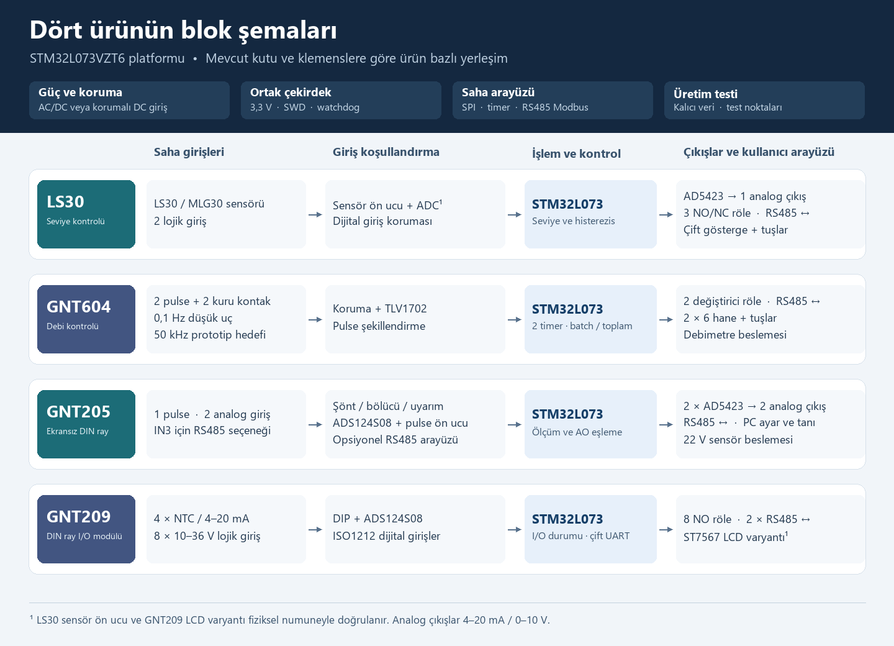

# LS30, GNT604, GNT205 ve GNT209 yenileme planı

**Revizyon 0.2 · 18 Kasım 2026**

Dört ürün için **STM32L073VZT6 tabanlı ortak yazılım ve tekrar kullanılabilir devre blokları**, her mevcut kutuya göre ayrı PCB yerleşimi öneriyorum. Mevcut kutular, kablolama uyumu ve kart başına kalibrasyonsuz çalışma tasarım girdisidir. Eski performans değerleri karşılaştırma tabanı oluşturur. Prototip, daha hızlı ölçüm, daha iyi saha tanılaması ve daha düşük üretim maliyeti için yeni hedefleri sınar.

**Geliştirme sırası güncellemesi.** İlk uygulama LS30’un ekransız varyantıdır. Ürün ailesindeki analog girişler, sinyal ve güç yolları dahil STM32 çekirdeğine karşı galvanik izole tasarlanır. Birden fazla analog girişi olan ürünlerde ayrı saha referansı isteyen kanalların kendi izolasyon alanı olur. Aynı saha COM’u paylaşan kanallar için grup izolasyonu ürün bazında tanımlanır. **LS30 A1** tek 220 VAC flyback, bağımsız AI sekonderi, çekirdekle ortak referanslı AO ve üç kuru kontak röle kullanır. [LS30 A1 tasarım notları](1.%20LS30/Hardware/LS30-Izole-Analog-A1/Tasarim-Notlari.md)

## 1. Eski ürünlerin karşılaştırma tabanı ve mevcut kutular

| Ürün | Besleme ve I/O | Mekanik ve uyumluluk |
| --- | --- | --- |
| **LS30** | Standart 230 VAC ±%10, opsiyonel 24 VDC ±%10, 4–5 W. Kılavuz 24 V modelde 24 VAC’yi ve DC polarite-bağımsız bağlantıyı da tarif ediyor. 1× LS30/MLG30 sensör girişi, 2× lojik giriş, 3× NO/NC kuru kontak (250 VAC / 3 A), 1× 4–20 mA / 0–10 V çıkış, 1× RS485. | Ön yüz 96 × 49 mm, pano kesimi 90 × 45 mm, yan çizimde 92 mm derinlik ölçüsü. İki gösterge, dört tuş, üç röle LED’i, sabitleme ayakları ve arka klemensler korunur. [Kılavuz s. 4–13, 15–24](1.%20LS30/Docs/LS30-Kontrolor-Montaj-ve-Kullanma-Klavuzu_v1_04_310123.pdf) |
| **GNT604** | Yerel şemada 220 VAC, üretici sayfasında opsiyonel 10–32 VDC ve en çok 4 W. 2× pulse (0,1 Hz–15 kHz), 2× kuru kontak fonksiyon girişi, 2× değiştirici röle, RS485, debimetre besleme çıkışı. Klemens 1 yerel şemada +20 VDC, üretici sayfasında AC model için +22 VDC / 50 mA. | Üretici sayfasında klemensler dahil 72 × 72 × 90 mm. Üst sıra kırmızı, alt sıra sarı, ikisi de altı hane ve 9 mm. Dört tuş ve durum LED’leri. Hangi besleme ve I/O opsiyonlarının sahada kullanıldığı etiket ve numuneyle eşleştirilir. [Bağlantı şeması](2.%20GNT604/Docs/Connection%20Diagram.png), [üretici ürün bilgisi](https://www.gentekelektronik.com.tr/debimetre-gostergesi/debimetre-olcum-ve-kontrol-cihazi) |
| **GNT205** | 24 VDC ±%10, 2,5 W, sensör beslemesi 22 VDC ±%10 ve 50 mA kısa devre koruması. 1× pulse, 2× 4–20 mA / 0–10 V / PT100 / NTC / PTC / ÖZEL giriş. Giriş 3 için ayrıca RS485 seçeneği. 2× bağımsız 16 bit analog çıkış (4–20 mA / 0–10 V / ÖZEL), 1× RS485 çıkış. Örnekleme ve tepki 100 ms, 0–50 °C, IP20. | **Ekransız DIN ray tasarımı.** Devreye alma ve tanılama mevcut RS485 üzerinden planlanır. Kutu ölçüsü, klemens haritası ve terminal başına sensör bağlantı biçimi fiziksel örnekle çıkarılır. [Proje parametreleri](3.%20GNT205/Docs/Project_Parameters.txt), [üretici ürün bilgisi](https://www.gentekelektronik.com.tr/ray-tipi-transmitter/gnt-205-ray-tipi-transmitter) |
| **GNT209** | 10–36 VDC / 3 W, 8× 10–36 VDC lojik giriş, siparişe bağlı 4× NTC 10 kΩ / 4–20 mA, 2× RS485, 8× NO kuru kontak (10 A / 250 VAC, 5 A / 30 VDC belge değeri). | Plastik DIN ray kutu, geçmeli klemensler, 157,4 × 91 × 58,4 mm nominal. Teknik çizimde genişlik 158 mm ve klemens dizisi için 5,08 mm adım gösteriliyor. Gerçek PCB sınırı, montaj delikleri ve takılan klemens dizisi fiziksel kutudan alınır. [Teknik özellikler](3.%20GNT209/Docs/Teknik%20%C3%96zellikler.png), [klemens şeması](3.%20GNT209/Docs/Ba%C4%9Flant%C4%B1%20%C5%9Eemas%C4%B1.png), [teknik çizim ve parametre tablosu](3.%20GNT209/Docs/Modbus_Haritas%C4%B1.png) |

Her kutu için eski PCB, klemensler, ön panel ve arka etiket üzerinden mekanik referans oluşturulur. PCB sınırı ve deliklere ek olarak iki yüzün parça yüksekliği, kutu tırnakları, AC/DC izolasyon alanı, LCD/LED, tuş, DIP, kablo büküm alanı ve fiş sökme mesafesi ölçülür. STM32’nin 14 × 14 mm LQFP100 gövdesi ve çevresindeki yönlendirme alanı özellikle GNT205’te yerleşim öncesi kontrol edilir. [STM32L073VZ paket bilgisi](https://www.st.com/en/microcontrollers-microprocessors/stm32l073vz.html)

### Prototipte denenecek iyileştirmeler

| Ürün | Önerilen iyileştirme ve ölçüm |
| --- | --- |
| **GNT205** | İki 4–20 mA veya 0–10 V giriş aktifken, bir girişteki basamaktan ona eşlenen analog çıkışın son değerin ±%1 FSR bandına yerleşmesine kadar **≤50 ms** hedefi. Hızlı ve parazit bastırmalı ölçüm profillerinin gerçek gecikmesi ayrı ölçülür. PT100/NTC/PTC ve pulse/RS485 kaynakları için gecikme sınırları sensör, sinyal ve sorgu aralığına göre verilir. 24 V nominalde **≤2,2 W** güç hedefi denenir. Ölçümde 22 V sensör çıkışı 50 mA seviyesinde, iki akım çıkışı 20 mA’de ve haberleşme aktiftir. Eski 2,5 W değeri besleme köşelerinde karşılaştırma için kaydedilir. |
| **GNT604** | **İki kanalda eşzamanlı 50 kHz** prototip hedefi. İlk testte yüksek ve düşük darbe süreleri en az 5 µs. Desteklenen kablo ve çıkış tipleriyle darbe şekli, sayım hatası ve gürültü bağışıklığı ölçülür. Debi ve toplamlar haberleşme ve panel aktifken doğrulanır. 0,1 Hz düşük uç da test edilir. |
| **GNT209** | Dört AI aktifken **≤100 ms tam tarama** hedefi ve kanal bazında geçerli/veri eski/giriş arızası durumu. Hızlı tarama ve şebeke paraziti bastırma profilleri ayrı ölçülür. Kapalı kutuda sekiz röle ve iki RS485 aynı anda çalışırken besleme gücü, sıcaklık artışı ve analog sapma kaydedilir. |
| **LS30** | Ölçüm ve röle karar döngüsünde **≤100 ms güncelleme aralığı** hedefi. Şamandıra mekaniği, ayarlanabilir ölçüm filtresi ve röle gecikmesinin etkisi basamak testinde ayrı ölçülür. Sensör arızası ve akım döngüsü açık/yük sınırı gibi tanılar, mevcut ekran ve Modbus üzerinden gösterilir. |

Bu değerler ön hedeflerdir. Eski cihazlar ve prototipler aynı test düzeneğiyle ölçülür. Seri üretim hedefleri doğruluk, parazit, kutu içi sıcaklık ve maliyet sonuçlarıyla birlikte seçilir. Maliyet için ilk hedef, aynı sipariş adedinde **kart başına toplam üretim maliyetinde %15 azalma**. Parça, PCB, montaj ve test birlikte hesaplanır. Eski BOM ve üretim süresi alınınca hedef yeniden değerlendirilir.

## 2. Ortak donanım ve entegre seçimi

| İşlev | İlk prototip seçimi | Üretim kararı |
| --- | --- | --- |
| MCU | **STM32L073VZT6**, 3,3 V, SWD, brownout, bağımsız watchdog. 32 MHz, 192 KB Flash, 20 KB SRAM, 6 KB veri EEPROM’u. | Ürün başına pin/alternatif işlev haritası. GNT604’te iki donanım sayacı, GNT209’da iki UART ve GNT205’te SPI, pulse ve olası ikinci UART aynı anda sınanır. [ST veri sayfası](https://www.st.com/resource/en/datasheet/stm32l073vz.pdf) |
| 4–20 mA giriş | **TI ADS124S08** + kanal başına 100 Ω Kelvin bağlantılı hassas şönt + RC ve terminal koruması. **ADR4525B** harici 2,5 V referans. | Doğruluk ve gürültü payı elverirse GNT209’da **ADS114S08** ve referans alternatifi değerlendirilir. **AD4111**, dört akım girişini ve gerilim girişlerini entegre eden alternatif. Akım giriş yolu 0–20 mA olarak belirtiliyor ve NTC/PT100 uyarımı ayrıca çözülüyor. [ADS124S08](https://www.ti.com/lit/ds/symlink/ads124s08.pdf), [ADS114S08](https://www.ti.com/product/ADS114S08), [ADR4525B](https://www.analog.com/en/products/adr4525.html), [AD4111](https://www.analog.com/en/products/ad4111.html) |
| 0–10 V ve direnç girişi | ADS124S08. Gerilim için yaklaşık **5:1** oranlı eşlenmiş bölücü. PT100 için ADC’nin IDAC/PGA’sı ve rasyometrik referans direnci. NTC/PTC için hassas referans direncine göre rasyometrik ölçüm. | Aynı klemens farklı modları taşıyorsa şönt ve uyarım yollarını birbirinden ayır. İlk tasarımda 4–20 mA şöntü ölçüm akımı yolunda doğrudan kullanılır. Anahtar seri direnci ölçümün parçası olacaksa sıcaklık ve kaçak etkisi bütçelenir. Tam giriş empedansı ve RTD tel sayısı klemenslere göre kesinleşir. [TI ADC ve RTD uygulamaları](https://www.ti.com/product/ADS124S08) |
| 4–20 mA / 0–10 V çıkış | **ADI AD5423** kanal başına bir adet. Aynı VIOUT ucunda mod seçimi, 16 bit, SPI, çıkış tanılama. Harici 2,5 V referans ve prototipte **13,7 kΩ hassas harici RSET**. | **DAC8760** maliyet adayı. 4–20 mA modunda dahili RSET ile ±%0,25 FSR TUE (harici 5 V referans ve veri sayfası koşullarında). Ortak klemens için TI `VOUT/IOUT` ve `VSENSE` uygulaması gerekir. **AD5758**, GNT205’te yeni güç hedefi veya kutu içi sıcaklık sınırı aşılıyorsa dinamik güç kontrollü aday. [AD5423](https://www.analog.com/media/en/technical-documentation/data-sheets/ad5423.pdf), [DAC8760](https://www.ti.com/lit/ds/symlink/dac8760.pdf), [TI ortak uç tasarımı](https://www.ti.com/tool/TIPD119), [AD5758](https://www.analog.com/en/products/ad5758.html) |
| RS485 | **THVD1410** düşük hızlı, izolesiz seçenek. Galvanik izolasyon gereken port için **ISO1410 ve izole DC/DC**. | 120 Ω sonlandırma seçenekli, bias saha topolojisine göre, klemens yakınında hat koruması. A/B ve DATA+/− yönü eski cihazla ölçülür. GNT209 COM1/COM2 toprak ve izolasyon ilişkisi ile eski rol belirlenir. [THVD1410](https://www.ti.com/product/THVD1410), [ISO1410](https://www.ti.com/product/ISO1410), [Modbus RTU kılavuzu](https://www.modbus.org/modbus-specifications) |
| Dijital ve pulse giriş | GNT209’un 10–36 V girişleri için 4× **ISO1212** ilk aday. GNT604/GNT205 pulse için korumalı giriş ağı + **TLV1702** histerezisli karşılaştırıcı, çıkışta 3,3 V pull-up. | ISO1212’de 10 V açma eşiği, kapama eşiği ve 36 V sürekli giriş akımı doğrulanır. Pulse girişinde NPN/PNP/açık kollektör/push-pull desteği, eşikler ve minimum yüksek/düşük süre eski cihaz ve sensörle tanımlanır. Kuru kontak girişinde pull-up, kablo koruması ve debounce. [ISO1212](https://www.ti.com/product/ISO1212), [TLV1702](https://www.ti.com/product/TLV1702) |
| Röle ve LED sürücü | **TPL7407L** röle sürücüsü (7 kanal). GNT209’da bir ek düşük taraf MOSFET ve bobin klempi veya 8 kanallı sürücü. **TLC59283** + hane anahtarları, mevcut LED modülü sabit akım sink mimarisine uygunsa. | Röle sınıfı, kontak yük tipi, ayak izi, bobin güç bütçesi ve açılış durumu numuneyle seçilir. GNT209’da klemens ve PCB’nin sekiz kanal birlikte çalışırken sıcaklık artışı ölçülür. [TPL7407L](https://www.ti.com/product/TPL7407L), [TLC59283](https://www.ti.com/product/TLC59283) |
| Güç | Geniş giriş DC seçeneği için **LM5164** buck, ters polarite ve darbe koruması, analog ray için filtre/LDO. LS30 ve GNT604 AC varyantları için izole AC/DC güç bloğu. | DC girişinde pasif koruma ve MOSFET çözümünü, eFuse seçeneğini ve montaj maliyetini kıyasla. LS30’un 24 VAC/DC varyantı doğrultma, minimum giriş ve AO gerilim payını ayrı geçer. Şebeke tarafı, röle kontakları ve SELV tarafı için ürün bazlı izolasyon ve kutu incelemesi. [LM5164](https://www.ti.com/product/LM5164), [IEC 61010-2-201](https://webstore.iec.ch/en/publication/64909), [IEC 61326-1](https://webstore.iec.ch/en/publication/62793) |

## 3. Kalibrasyonsuz analog tasarım

**Kabul politikası.** Kart başına analog offset/gain katsayısı yazmadan ve servis ayarı gerektirmeden, nominal parça değerleri ve üretici trim’i ile ürün limitleri sağlanır. Üretimde referans cihazla otomatik geçer/kalır testi yapılır. Sensör tipi, mühendislik ölçeği ve gerekiyorsa tankın fiziksel uç noktaları devreye alma parametresidir. LS30’un `r.Lo`/`r.Hi` referans işlemi, sahadaki sensör ve montaj koşuluyla ilgilidir. Parametresiz sensör değişimi gerekiyorsa önce sensör uç değerlerinin modelden modele toleransı ölçülür.

### Analog giriş

- **4–20 mA:** 100 Ω ile 4/12/20 mA sırasıyla 0,4/1,2/2,0 V olur. 24 mA’de 2,4 V ve şöntte yaklaşık 58 mW oluşur. İlk seçim ±%0,025, ≤5 ppm/°C, en az 0,25 W Kelvin bağlantılı şönt. 0,25 W nominal güç yanlış kablo bağlantısına karşı koruma sağlamaya yetmez. Akım sınırlama, kısa devre ve 24 V yanlış bağlantı davranışı ayrı doğrulanır. Akım döngüsüne eklenen toplam yük gerilimi, verici ve kabloyla birlikte hesaplanır. ADC’nin kazanç ve ortak-mod sınırları her mod için kontrol edilir. [ADS124S08](https://www.ti.com/lit/ds/symlink/ads124s08.pdf), [TI akım giriş tasarımı](https://www.ti.com/document-viewer/lit/html/SSZTA14/GUID-6DB50EC8-054D-4C74-8345-64C80F8F211D)
- **0–10 V:** 10 V nominalde yaklaşık 2 V olacak bölücüyle ADC referansına ve giriş korumasına pay bırak. Eşlenmiş direnç ağının oran toleransını ve oran sıcaklık katsayısını kullan. Ölçüm sapmasını bölücü empedansı, koruma kaçağı, kablo kaynağı ve 0 V yakınındaki ADC davranışıyla birlikte değerlendir.
- **PT100 / NTC / PTC:** PT100’de tel bağlantısına göre 3/4 telli kompanzasyonu seç. 2 telli modda 1 Ω toplam kablo direnci 0 °C civarında yaklaşık 2,6 °C ek hataya yol açar. NTC ve PTC’de onaylı sensör eğrisi, tolerans, kablo ve kendiliğinden ısınma varsayımları ayrı tanımlanır. GNT209’da iki 10 kΩ NTC profili için aynı R25 değerinden bağımsız olarak gerçek eğriler alınır. [TI PT100 devreleri](https://www.ti.com/product/ADS124S08)
- **Yanlış bağlantı koruması:** Akım kolunda **TPS2661x** ve terminal TVS’i ilk karşılaştırma adayı. Tipik 7,5 Ω seri direnç 20 mA’de yaklaşık 0,15 V ek yük getirir. Kelvin algılama şönt uçlarından yapılır. Tezgâhta TVS kaçağı, koruma açma davranışı, döngünün cihaz enerjisizken çalışması gerekiyorsa uygun varyant ve açık/ters giriş sınanır. [TPS2661x veri sayfası](https://www.ti.com/lit/ds/symlink/tps2661.pdf)

### Analog çıkış

- **LS30’da bir, GNT205’te iki AD5423.** 0–10 V ve 4–20 mA arasında ortak klemens seçimine uygun. Donanım ve yazılım açılış davranışını birlikte tanımlar. Çıkış, geçerli konfigürasyon ve sağlıklı ölçüm alınana kadar devre dışı tutulur. Mod değişiminde çıkış kapatılır, mod ve ilk kod yüklenir, ardından tekrar etkinleştirilir. 4 mA, Hi-Z, 0 V veya son değeri tutma gibi arıza durumları ürün bazında belirlenir. [AD5423 veri sayfası](https://www.analog.com/media/en/technical-documentation/data-sheets/ad5423.pdf)
- **Gerilim ve yük payı.** LS30’un 500 Ω sınırında 20 mA için yükte 10 V gerekir. AD5423’ün 2,3 V minimum pozitif payı ve koruma/kablo düşümü eklenir. İlk prototipte yaklaşık +15 V çıkış güç rayı ve 0 V uç noktasını sağlamak için negatif ray öngörülür. Veri sayfası gerilim modunda 2 V alt ray payı belirtir. Gerilim çıkışını ilk kabulde ≥1 kΩ ve tanımlı kablo kapasitansıyla sınarız. GNT205’in akım yükü 500 Ω başlangıç hedefidir. [AD5423 elektriksel sınırları](https://www.analog.com/media/en/technical-documentation/data-sheets/ad5423.pdf)
- **GNT205 güç bütçesi.** 22 V × 50 mA sensör yükü yaklaşık 1,1 W. İki akım kanalı 24 V rayından doğrudan beslenirse yalnızca akım yolları girişten nominalde yaklaşık 0,96 W daha çeker. İlk seçenek regüle +15 V rayla prototip ve kutu içi termal test. Sensör beslemesinin 50 mA sınırı normal yükte ve kısa devrede, minimum 21,6 V cihaz beslemesinde de ölçülür. 22 V ±%10 izinli aralık 19,8–24,2 V olduğundan düşük girişte regülatör ve koruma toplam düşümü için en çok 1,8 V vardır. Yeni güç hedefi ve eski 2,5 W değeri, iki AO en yüksek çıkışta, sensör yüklü ve haberleşme etkin iken karşılaştırılır.
- **Sensör beslemesi.** Düşük düşümlü regülatör ve 50 mA civarında ayarlanabilen **TPS2662x** ilk deneme adayları. Normal çalışma akımı ile kısa devre sınırının toleransları örtüşürse devre için ayrı açma ve sınırlama eşikleri tanımlanır. LDO zinciri 19,8 V alt sınırını koruyamazsa buck-boost seçeneği değerlendirilir. [TPS2662x veri sayfası](https://www.ti.com/product/TPS2662)

### İlk doğruluk hedefleri

Önerilen prototip hedefi **4–20 mA ve 0–10 V girişlerinde ±%0,25 FSR**, çıkışlarında **±%0,20 FSR**, ilgili ürün sıcaklık ve yük aralığında. 4–20 mA için FSR **16 mA** olduğundan sınırlar girişte ±40 µA, çıkışta ±32 µA. 0–10 V için karşılıkları ±25 mV ve ±20 mV. 16 bit çıkış kod adımı yaklaşık 0,244 µA veya 153 µV. PT100, NTC ve PTC için hedefler sensör sınıfı, kablo ve sıcaklık aralığıyla birlikte °C olarak belirlenir. LS30 sensör arayüzü için hedef saha numunesi ölçümünden sonra hesaplanır.

| Örnek ön bütçe | Tam skala aralığına göre mutlak katkı | Açıklama |
| --- | --- | --- |
| **4–20 mA giriş** | Yaklaşık **±%0,21 FSR** | 25 °C’ye göre kartta 25 °C sapma varsayımıyla şönt ~%0,038, referans ~%0,073 (başlangıç, lehim kayması ve tam aralık drift payı), ADC kazanç ~%0,015. Ölçek hataları 20/16 ile çarpılır. Offset/INL için %0,013 ve koruma, yerleşim, gürültü ve yaşlanma için %0,04 tasarım payı eklenir. |
| **0–10 V giriş** | Yaklaşık **±%0,20 FSR** | Bölücü için başlangıç oran hatası ±%0,05 ve ≤5 ppm/°C oran drift’i hedefinde toplam ~%0,063. Referans %0,073, ADC kazanç %0,015, offset/INL %0,010, kart/koruma %0,04. Bu bütçe seçilen giriş empedansı ve gerçek kaçakla kontrol edilir. |
| **4–20 mA çıkış** | Yaklaşık **±%0,19 FSR** | AD5423 harici RSET ile ±%0,05 TUE (ideal direnç ve harici referans koşulları), 13,7 kΩ RSET için %0,033 (±%0,02, ≤5 ppm/°C, ΔT = 25 °C), referans için %0,073 ve kart/yaşlanma için %0,03 bütçe. Üreticinin RSET toplama yöntemi esas alınır. |
| **0–10 V çıkış** | Yaklaşık **±%0,15 FSR** | AD5423 trimli 0–10 V aralığında ±%0,05 TUE, referans %0,073, yerleşim/koruma/yaşlanma %0,03. Bu bütçe 0 V uç noktası ve yükte sense ölçümüyle doğrulanır. |

Bu ön bütçeler bileşen verileri ve mühendislik paylarıyla oluşturuldu. Kutu içi parça sıcaklığı ortam sıcaklığının üstüne çıkarsa bütçe ölçülen sıcaklıkla yeniden hesaplanır. Son limitler yük, gürültü, kablo, koruma, üretim saçılımı ve ölçüm cihazı belirsizliği dahil edilerek onaylanır. [ADS124S08 elektriksel özellikleri](https://www.ti.com/lit/ds/symlink/ads124s08.pdf), [AD5423 elektriksel özellikleri ve RSET hesabı](https://www.analog.com/media/en/technical-documentation/data-sheets/ad5423.pdf), [ADR4525B referans tablosu](https://www.analog.com/media/en/technical-documentation/data-sheets/adr4520_4525_4530_4533_4540_4550.pdf)

## 4. Ürün başına uygulama kararları

- **LS30.** Sensör klemensi `1/+`, `2/IN`, `3/−`. Eski cihaz ve iki sensör numunesinde besleme gerilimi, akımı, uçtan uca sinyal aralığı, kaynak empedansı, kopuk/kısa devre, şamandıra hareketi ve varsa direnç oranı ölçülür. ADC ön ucu bu ölçümle seçilir. AO 9/10, RS485 11/12, iki lojik giriş 7/8. Dört AO yön modu, röle histerezisi ve menü dizisi korunur. DIP konumu yazılımdaki `out` ile uyuşmadığında AO kapatılarak durum gösterilmesi ilk tasarım önerisi. Eski AC ve 24 V varyantları ayrı kabulden geçer. [LS30 kılavuzu](1.%20LS30/Docs/LS30-Kontrolor-Montaj-ve-Kullanma-Klavuzu_v1_04_310123.pdf)
- **GNT604.** İki pulse kanalı için bağımsız donanım sayacı, zaman damgası ve taşma uzatma. STM32L073’te TIM2/TIM3 **16 bit**. Yüksek frekansta donanım pulse sayımı ve pencere başına fark, düşük frekansta periyot ölçümü. 0,1 Hz’de kenarlar 10 saniye aralıklı olduğundan ilk geçerli hız ve sıfır akış zaman aşımı tanımlanır. Eski 15 kHz sınırında periyot 66,7 µs, yeni 50 kHz hedefinde 20 µs. Şekillendirme ve timer filtreleri yeni hedefin minimum HIGH/LOW sürelerine göre boyutlanır. Debimetre K-faktörü, anlık/batch/global toplamlar, 13 tuş ve 18 lojik giriş fonksiyonu, iki rölenin 17 fonksiyonu, gecikmeler ve manuel komut öncelikleri eski cihazla doğrulanır. [GNT604 ürün bilgisi](https://www.gentekelektronik.com.tr/debimetre-gostergesi/debimetre-olcum-ve-kontrol-cihazi), [STM32 zamanlayıcıları](https://www.st.com/resource/en/datasheet/stm32l073vz.pdf)
- **GNT205.** IN2/IN3 için önce ortak ADC dene. 100 ve 200 SPS düşük gecikme ayarlarında ilk dönüşüm sırasıyla yaklaşık 10,2 ve 5,2 ms/kanal sürer. Bu süreye harici RC, mod yerleşmesi ve yazılım filtresi eklenir. 20 SPS’de ilk dönüşüm yaklaşık 56,5 ms/kanal olduğu için iki kanallı tarama eski 100 ms değerini de aşabilir. Hız ve parazit ölçümleri sonucunda tek ADC ile ayarlanabilir filtre veya her girişe ayrı ADC karşılaştırılır. RS485 üzerinden canlı ölçüm, bağımsız giriş-çıkış eşleme, ayar profili alma/yükleme ve hat arızası gösterimi planlanır. Ek 0–5 V ve 0–20 mA çıkış aralıkları, mevcut klemens ve aynı donanımla doğrulanırsa seçenek olarak açılır. IN3 RS485’in fiziksel portu ve rolü, AO yük limitleri ve `ÖZEL` modları eski numuneyle eşleştirilir. [ADS124S08 Tablo 13](https://www.ti.com/lit/ds/symlink/ads124s08.pdf), [AD5423 çıkış aralıkları](https://www.analog.com/media/en/technical-documentation/data-sheets/ad5423.pdf), [GNT205 ürün bilgisi](https://www.gentekelektronik.com.tr/ray-tipi-transmitter/gnt-205-ray-tipi-transmitter)
- **GNT209.** Klemensler güç 1–2, AI 3–10, DI/COM 11–20, sekiz röle 21–36, iki RS485 37–40. DI COM gruplarının iç bağlantısı ve AI dönüşlerinin ortak mı bağımsız mı olduğu ölçülür. Varsayılan konfigürasyonda DIP ve Modbus profili birlikte doğrulanır. Paylaşılan belgede `285, 297, 309, 321` Float R/W giriş tipi adresleri var. Kodlar `0 = NTC 100 °C`, `1 = NTC 200 °C`, `2 = 4–20 mA`. Adres tabanı, byte/word sırası ve diğer kayıtlar mevcut PLC/PC trafiğinden çıkarılır. Analog giriş opsiyonunun hangi SKU’larda kullanıldığı eşleştirilir. [Klemens şeması](3.%20GNT209/Docs/Ba%C4%9Flant%C4%B1%20%C5%9Eemas%C4%B1.png), [kayıt tablosu](3.%20GNT209/Docs/Modbus_Haritas%C4%B1.png)
- **GNT209 LCD varyantı.** Klasördeki JHD12864-G551IBFWD, ST7567 128 × 64. Modül 69,54 × 48,84 × 5,10 mm, görünür alan 65,40 × 37,00 mm, arka ışık yaklaşık 3 V / 75 mA. Belgedeki mekanik çizim pin 1’i PSB olarak, pin tablosu ise pin 3’ü PS olarak gösteriyor. Gerçek LCD ve FPC soketinin pin sırası, yönü, 3 V mantık seviyeleri, ön kapak açıklığı ve hangi ürün varyantında kullanıldığı doğrulandıktan sonra seri sürücü/konnektör haritası kesinleşir. [JHD LCD veri sayfası s. 4–10](3.%20GNT209/Docs/JHD12864-G551IBFWD.pdf)

LS30 için uyumluluk testine `Open` ve `err` göstergeleri, `on=off=0` ile röle devre dışı bırakma ve eşiklerin eşit olduğu diğer durumlar alınır. GNT209’da 20 SPS düşük gecikme filtresiyle dört kanalın ilk dönüşüm toplamı yaklaşık 226 ms’dir. Tam tarama süresi ve Modbus’a yansıyan veri yaşı mevcut cihaz ölçülerek belirlenir. [LS30 kılavuzu s. 17 ve 26](1.%20LS30/Docs/LS30-Kontrolor-Montaj-ve-Kullanma-Klavuzu_v1_04_310123.pdf), [ADS124S08 Tablo 13](https://www.ti.com/lit/ds/symlink/ads124s08.pdf)

## 5. Ortak yazılım geliştirme planı

| Katman | Kapsam |
| --- | --- |
| Donanım erişimi | STM32CubeL0 ve C ile ürün bazlı pin, saat, timer, SPI, UART/DE ve I/O yapılandırması. ADC `DRDY`, DAC `FAULT`, ön panel tarama, SWD. GNT604’te hassas zaman tabanı ve timer taşma/DMA testleri. Zaman kritik işlemler için kesme/DMA, ortak işler için bloklamayan ana döngü. |
| Ortak servisler | Analog ham sayım → elektrik birimi → mühendislik birimi, RTD/NTC dönüşümü, sinyal geçerliliği ve zaman damgası. Röle histerezisi/gecikmesi, DI debounce, HMI, watchdog, brownout ve arıza durumları. Çıkışların donanımsal açılış varsayılanı ve yazılımsal arıza politikası ürün ayarlarından yüklenir. |
| Haberleşme ve devreye alma | Ayrı port bağlamlarıyla Modbus RTU, CRC ve çerçeve zamanlaması. Çift portta eşzamanlı erişim ve toplu yazma tutarlılığı. Kullanılan eski fonksiyon kodu, register adresi, veri tipi ve başlangıç değerleri uyumluluk testine girer. Yeni kanallar, tanılar ve ayarlar sürümlü bir register alanında yayımlanır. GNT205’in ekran yerine RS485 üzerinden kullanılan PC aracı için çevrim içi değer, arıza ve ayar yedeği işlevleri planlanır. Eski PC/PLC senaryoları gerçek cihazla denenir. |
| Kalıcı veri | Sürüm, CRC ve sıra numarasıyla iki geçerli kayıt yaklaşımı. Güç kesintisinde son tam kayıt geri yüklenir. GNT604 kümülatif sayacı dahili olarak 64 bit tutar. Kayıt aralıkları, güç kesintisinde kabul edilebilir toplam kaybı ve EEPROM ömrü birlikte belirlenir. Dış register taşma davranışı eski cihazla uyumluluğa göre korunur. |
| Ürün uygulamaları | LS30 seviye/menü/röle, GNT604 iki debi hattı ve batch, GNT205 kaynak seçimi ve iki bağımsız AO, GNT209 I/O görünümü, DIP/NTC profilleri ve çift COM. Aynı kaynak tabanından dört ayrı ürün yazılımı. |

## 6. İş sırası ve geçiş koşulları

| Aşama | İş | Çıkış ölçütü |
| --- | --- | --- |
| **A · Eski ürün referansı** | Dört fiziksel numunede mekanik ve klemens ölçümü. Besleme varyantları, sensör elektriksel özellikleri, çıkış yükleri, Modbus/PC uyumu, röle davranışı. Eski BOM, montaj süresi, üretim ayar/test süresi ve güç/tepki ölçümü. | Kutu ve terminal tablosu, saha uyumluluk listesi, eski performans ve maliyet karşılaştırma tabanı. |
| **B · LS30 ve izleyen tezgâh prototipleri** | Önce **LS30 ekransız A1** için 1× izole AI ve 1× ortak referanslı AO, ayarsız doğruluk ve yanlış bağlantı/izolasyon denemeleri. Ardından GNT205: 2× AI ve 2× AO, ≤50 ms basamak tepkisi ve ≤2,2 W nominal güç. GNT604: eşzamanlı 15 ve 50 kHz, 0,1 Hz, kısa darbe ve taşma. | LS30’dan ortak analog devre ve STM32 sürücüleri. İzleyen ürünlerden çok kanallı güç/ısı bütçesi ve gerçek pulse giriş şartları. |
| **C · Kutuya uyarlama** | LS30 sensör zinciri ve GNT209 DIP/analog opsiyonu. Dört ürün için kart konturu, yükselti, klemens ve izolasyon yerleşimi kontrolü. GNT209’da ortak ADC, 16 bit maliyet adayı ve gerekirse yavaş/hızlı profilleri tart. Ortak parça kullanımı, opsiyonlu montaj ve azalan test süresini eski üretimle kıyasla. | İzolasyon/zemin topolojisi, ön panel ve klemens uyumu, örnek üretim adedinde parça/montaj/test maliyeti. |
| **D · Doğrulama** | AI/AO için 4/12/20 mA ve 0/5/10 V; 0/25/50 °C ilgili ürünlerde; min/nom/maks besleme, kablo ve yük köşeleri, röleler aynı anda anahtarlarken gürültü. Termal, kısa devre, açık devre, güç kesintisi, Modbus ve EMC ön testleri. Yerleşimde şebeke/kontak izolasyonunu ve derating’i doğrula. | Kart başına düzeltme katsayısı kullanmadan tüm test noktaları geçer. Eski cihaz karşılaştırması ve pilot üretim geçer/kalır prosedürü tamamlanır. |

**Aşama A’da öncelikli girdiler.** GNT205’in kutusu ve etiketli klemens fotoğrafı, çalışan LS30 ve MLG30 sensörleri, 220/230 VAC ve DC ürün varyantları, GNT604’ün gerçek debimetre/pulse kaynakları, eski RS485 register dosyaları veya çalışan cihaz-PC seti. GNT209 için analog opsiyonlu numune, NTC parça numaraları ve gerçek LCD/FPC. Doğruluk, izolasyon ve hedef BOM maliyeti ürün gereksinimi olarak bu aşamada onaylanır.
