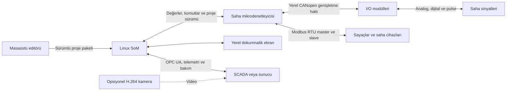

# rtuOPC proje bilgisi

Son güncelleme: 18 Kasım 2026

## Amaç ve mevcut durum

Allwinner S3 tabanlı mevcut kartlarla Modbus RTU, Ethernet ve saha I/O işlevlerini bir araya getiren bir endüstriyel RTU ve ağ geçidi geliştirmek. İlk hedef, S3'ü microSD'den açıp bir RS-485 cihazından Modbus RTU yanıtı almak ve Ethernet üzerinden erişimi doğrulamak.

**İlk tezgâh seti MTSOMS3 (SGW) + MTSGW R09.** Set, eMMC'deki mevcut Linux 5.4.111 imajıyla seri konsola kadar açıldı. R09 şemasında iki RS-485 kanalı, iki Ethernet portu, dört dijital giriş ve iki kuru kontak röle çıkışı var. Saha işlevleri için doğrulama durumu ölçüm kaydında tutuluyor. R01, RS-232 gerektiğinde değerlendirilebilecek ikinci kart.

Yeni çalışmaya bu dosyadan başla. Tamamlanan testin kart revizyonunu, sonucu ve varsa log veya ölçüm bağlantısını **Ölçüm kaydı** bölümüne ekle. Pin tablosunu veya sonraki adımı değiştiren bir bulgu varsa ilgili bölümü de güncelle.

## Ürün mimarisi ve pilot planı

İlk saha pilotu ekranlı ve modüler bir RTU olacak. Dört 4–20 mA, iki 0–10 V ve dört 0–10 kHz kare dalga girişini okuyacak. Ölçümleri yerel ekranda gösterecek ve masaüstünde seçilen HTTPS API veya MQTT hedeflerine gönderecek. Pulse sayımı, Linux yeniden başlarken ve tanımlanacak güç kesintisi süresi boyunca devam edecek. Akış ölçümü proses izleme ve kontrol için. Faturalamaya esas ölçüm kapsam dışı. Kamera opsiyonel. Mevcut MTSOMS3 + MTSGW R09, seri haberleşme ve ağ yazılımını geliştirmek için tezgâh platformu. Ürün pilotu, ayrı analog giriş ve pulse modüllerini kullanacak.

### İşlemcilerin görevleri

- **Ana RTU mikrodenetleyicisi** kontrol çevrimini, yerel CANopen ağ yönetimini ve iki Modbus RTU portunu çalıştırır. Saha haberleşmesi ayrı bir görev olarak yürür ve kontrol çevrimine zaman damgalı bir veri kopyası verir. MCU'nun besleme, reset ve watchdog düzeni Linux yeniden başlarken saha görevlerinin devam etmesini sağlar.
- **I/O modülü mikrodenetleyicileri** kendi analog örnekleme ve filtrelemelerini, dijital girişlerini, pulse sayaçlarını ve çıkış sürücülerini yönetir. Analog örnekleme ve pulse sayımı, modüller beslendiği sürece ana RTU ile bağlantı kesilse de sürer. STM32G4, donanım zamanlayıcıları ve FDCAN sayesinde tezgâh adayıdır. Pulse modülünün kesin MCU seçimi dört eşzamanlı sayım kanalı ile periyot yakalama için gereken pin, zamanlayıcı ve DMA eşlemesine bağlıdır. [STM32G474 veri sayfası](https://www.st.com/resource/en/datasheet/stm32g474pb.pdf)
- **Linux SoM** HMI, OPC UA sunucusu, ağ tabanlı cihaz sürücüleri, olay ve trend kayıtları, modem yönetimi, proje aktarımı ve güncellemeleri çalıştırır. Ethernet, Wi-Fi ve hücresel bağlantı politikası burada yaşar. Linux üzerinden gelen saha değerlerine veri yaşı sınırı atanır. Örneğin bir IP sayaçtan veri kesilirse mikrodenetleyici o değeri bayat olarak işaretler ve blokta seçilen davranışı uygular.
- **Çıkış yetkisi** ana RTU mikrodenetleyicisinde toplanır. HMI ve SCADA bir komut isteği gönderir. Kontrol programı, çalışma modu ve proses izinlerini değerlendirip hedefi I/O modülüne iletir. Modül komutu uygular ve bağlantı kaybında yapılandırılan çıkış davranışını yerel olarak yürütür. Komut, kabul durumu ve fiziksel geri bildirim ayrı tutulur. Röle kontağının fiziksel durumu yardımcı kontak veya benzer bir saha girişiyle doğrulanabilir.
- **Linux SoM ile ana RTU mikrodenetleyicisinin bağlantısı** aynı kartta 3,3 V UART ile başlayabilir. Protokol sürümü, çerçeve bütünlüğü, sıra numarası, komut onayı, canlılık ve zaman aşımı gerekir. Yerel I/O genişletme hattı ana RTU mikrodenetleyicisinden çıkar.

### Modüler ürün ve ilk pilot bileşenleri

Ürün tek bir DIN ray ana ünitesi etrafında genişler. Masaüstü projesi, takılı modülleri ve bağlantı seçeneklerini tanımlar. Aynı ana ünite ekransız veya 5–7″ HMI ile çalışır.

| Bileşen | İlk pilot ve ürün planı |
| --- | --- |
| Ana RTU | 24 V DC besleme, Linux SoM, kontrol MCU'su, kalıcı depolama, watchdog, bir Ethernet, iki izole RS-485 ve yerel CANopen genişletme portu. Ethernet yerel devreye alma ve bakım için standarttır. Saha CAN/CAN FD için ayrı fiziksel arayüz ayrılır. İkinci Ethernet, ayrı saha ve üst ağ gereksinimiyle değerlendirilir. |
| Analog giriş | Bir dört kanallı kart tasarımı, pilotta iki kart. Birinci kart dört 4–20 mA sinyalini, ikinci kart iki 0–10 V sinyalini okur ve iki kanal boş kalır. Kanal modu, klemens bağlantısı ve giriş koruması birlikte doğrulanır. |
| Pulse ve frekans | Bir dört kanallı 0–10 kHz sayaç kartı. Donanım zamanlayıcıları, yerel kalıcı toplam ve supercap besleme alanı kart üzerindedir. Ana üniteye toplam, frekans, ölçüm kalitesi ve yedek enerji durumu gönderilir. |
| Analog çıkış | Ölçeklenmiş 4–20 mA çıkış ilk saha uygulamasında kullanılacaksa bir AO modülü pilotta eklenir. Tezgâhta en az bir yüklü çıkışta ölçekleme doğrulanır. Nihai kanal sayısı ve 0–10 V çıkış kapsamı açık karardır. |
| Dijital I/O ve röle | 24 V DI, transistor DO ve kuru kontak röle genişletme ailesine eklenir. R09'un mevcut girişleri ve röleleri ilk yazılım testlerinde kullanılabilir. |
| HMI ve haberleşme seçenekleri | Pilot için 7″ ekran. Ayrı pano kapağına Ethernet HMI, cihaz içi kısa bağlantıya uygun DSI/LVDS panel değerlendirilir. LTE/2G ve Wi-Fi/BLE takılabilir seçeneklerdir. LoRa rolü saha kullanımına göre seçilir. Kamera opsiyoneldir. |

### Yerel CANopen genişletme hattı

- **Fiziksel bağlantı.** İlk prototip aynı pano içinde kablolu bir doğrusal hat kullanır. `CAN_H` ve `CAN_L` bükümlü çift üzerinden taşınır. Konnektörde `+24 V` ve `0 V` besleme bağlantısı bulunur. CAN referansı ve ekran bağlantısı izolasyon planına göre belirlenir. İki fiziksel uçta 120 Ω sonlandırma kullanılır. Ana RTU uçta yer alır, son modülde sonlandırma etkinleştirilir. Ara modül bağlantıları kısa tutulur. Her modül dalının akım sınırı, gerilim düşümü, açılış akımı ve kısa devre davranışı ölçülür. İlk prototipte modül değişimi enerjisi kesilerek yapılır. [CiA CAN ağ tasarımı](https://www.can-cia.org/can-knowledge/designing-a-can-network)
- **Protokol.** Yerel hat klasik CAN üzerinde **CANopen CC, 500 kbit/s, 11 bit CAN kimliği** kullanır. Ana RTU MCU'su ağ yönetimini yürütür. PDO proses verisini, SDO kimlik ve izinli parametreleri, heartbeat düğüm durumunu taşır. Analog/dijital nesnelerde CiA 401 esas alınır. Pulse toplamı, ölçüm kalitesi ve güvenli veri aktarımı sürümlü uygulama eşlemesi kullanır. [CiA 401 I/O profili](https://www.can-cia.org/can-knowledge/cia-401-series-i/o-device-profile) · [CiA ağ yönetimi](https://www.can-cia.org/can-knowledge/network-management/) · [CiA bağlantı gözetimi](https://www.can-cia.org/can-knowledge/error-control-protocols)
- **Bağlantı ve güç kaybı.** Heartbeat veya yeni ölçüm zaman aşımında ana ünite veri kalitesini günceller. AO/DO/röle modülü geçerli komut kesildiğinde kanal için tanımlı davranışa geçer. Yeniden bağlantıda kimlik ve proje eşleşmesi doğrulanır, eski komut uygulanmaz. Pulse modülü kendi sayımını sürdürür ve yeniden bağlantıda mutlak toplamı yayınlar. Supercap beslemesinin 24 V hattına geri akması engellenir. Ana CAN hattı enerjisizken sayım modülünün transceiver davranışı test edilir.
- **Mekanik.** İlk tezgâhta bir analog modül ve bir pulse modülüyle bağlantı doğrulanır. Pilot ikinci analog modülle altı girişi kapsar. Pano içinde yan yana takılan arka bağlantı, kablolu pilot doğrulamasından sonraki mekanik aşamadır.

#### Konnektör ve adresleme

Pilot yerel genişletme portu, 5 pinli, anahtarlı ve sökülebilir **open-style** klemens kullanır. Pin numaraları kart üzerindeki işaretlere göre okunur. Modüllerin `EXP IN` ve `EXP OUT` pin sırası aynıdır. Ana ünitede korumalı 24 V çıkış, son modülde seçilebilir sonlandırma bulunur. Saha CAN portunun konnektörü fiziksel olarak farklı olmalıdır. [CiA 106](https://www.can-cia.org/can-knowledge/cia-106-connector-pin-assignment) · [SICK open-style pin örneği](https://www.sick.com/media/docs/1/71/071/operating_instructions_flexi_classic_gateways_en_im0024071.pdf)

| Pin | Sinyal | İşlev |
| --- | --- | --- |
| 1 | `0V_EXP / CAN_GND` | Genişletme besleme dönüşü ve hat tarafı CAN referansı. |
| 2 | `CAN_L` | Diferansiyel çiftin düşük hattı. |
| 3 | `SHIELD` | Kablo ekranı. Şasi/FE bağlantısı EMC tasarımında doğrulanır. |
| 4 | `CAN_H` | Diferansiyel çiftin yüksek hattı. |
| 5 | `+24V_EXP` | Ana ünitenin akım sınırlamalı modül beslemesi. |

Hat 120 Ω karakteristik empedanslı bükümlü çiftle kurulur. Pilot başlangıç sınırı aynı pano içinde **5 m toplam hat ve 20 cm azami dal**. Bunlar üretim sınırı için başlangıç varsayımlarıdır. Besleme ve sinyal referansının geçtiği izolasyon sınırları şemada ayrı gösterilir. Ekran, besleme dönüşü olarak kullanılmaz. Supercap ana 24 V hattına geri besleme yapmaz. [CiA CAN ağ tasarımı](https://www.can-cia.org/can-knowledge/designing-a-can-network)

| Düğüm adresi | Atama |
| --- | --- |
| `1` | Ana RTU MCU'su. |
| `2`, `3`, `4`, `5` | Pilot sırasıyla analog giriş A, analog giriş B, pulse ve opsiyonel AO. |
| `6–17` | İlk ürün hedefinde ek yerel modüller. Toplam hedef 16 genişletme modülü. |
| `18–127` | Gelecek ürün profilleri ve servis için ayrılmış geçerli CANopen adresleri. |

İlk tezgâhta modüllere ayrı ayrı servis bağlantısından adres verilir ve kalıcı belleğe yazılır. Sonraki devreye alma akışında CiA 305 LSS ile kimliğe göre seçici adresleme kullanılır. Yeni kart açık servis işlemiyle kaydedilir. Ana ünite `0x1018` kimliğini, firmware/profil sürümünü ve benzersiz modül kimliğini proje ile karşılaştırır. Adres ve kimlik eşlemesi tamamlanana kadar çıkışlar başlangıç durumunda kalır. Aynı adresteki iki düğümün eşzamanlı sorgusuna güvenmek yerine ilk kayıt tek modülle veya seçici LSS ile yapılır. Bakımda yeni seri numarası yetkili olarak aynı mantıksal konuma eşlenir ve tag'ler korunur. [CiA 305 LSS](https://www.can-cia.org/can-knowledge/cia-305-layer-setting-services-lss)

#### 500 kbit/s kapasite hesabı

11 bit kimlikli 8 bayt klasik CAN çerçevesi için çerçeveler arası boşluk ve bit stuffing dahil **135 bit** bütçele. Heartbeat için **65 bit**, düğüm başına **1 s** kullan. Ana ünite heartbeat'ine ek olarak saniyede 100 adet olası SYNC mesajı için de 135 bit/mesaj üzerinden pay ayır. Sürekli planlı trafik hedefi **%40**. Kalan pay başlangıç, tanı, SDO, hata tekrarları ve ani trafik içindir. Bu ortalama yük hesabı, öncelik ve en kötü yanıt süresi analizinin girdisidir. [CiA ağ tasarımı](https://www.can-cia.org/can-knowledge/designing-a-can-network) · [CiA konferans bildirisi, hat yükü hesabı](https://can-cia.org/fileadmin/cia/documents/proceedings/2015_bendermann.pdf)

`Sabit bit/s = 100 × 135 + 65 = 13.565`. `Modül bit/s = çerçeve sayısı × 135 × 1000 / periyot_ms + 65`. Aynı tip modüller için `⌊(500.000 × 0,40 − 13.565) / modül bit/s⌋`. Aşağıdaki sonuçlar trafik tavanıdır. İlk ürün hedefi ayrıca **en çok 16 modül** ile sınırlandırılır ve her proje, modül karışımına göre bütçelenir.

| Periyot | 1 çerçeve | 2 çerçeve | 4 çerçeve | 8 çerçeve | 9 çerçeve |
| --- | ---: | ---: | ---: | ---: | ---: |
| 5 ms | 6 | 3 | 1 | 0 | 0 |
| 10 ms | 13 | 6 | 3 | 1 | 1 |
| 20 ms | 27 | 13 | 6 | 3 | 3 |
| 50 ms | 67 | 34 | 17 | 8 | 7 |
| 100 ms | 131 | 67 | 34 | 17 | 15 |

| Pilot profili | Adet | Toplam çerçeve/modül/güncelleme | Periyot | Hesaba giren veri |
| --- | ---: | ---: | ---: | --- |
| 4 AI | 2 | 4 | 20 ms | Dört 16 bit değer, sayaç/kalite bilgisi ve 128 bit doğrulama etiketi. |
| 4 pulse | 1 | 9 | 50 ms | Dört 64 bit toplam, dört 32 bit frekans, sayaç/kalite ve 128 bit doğrulama etiketi. |
| AO, opsiyonel | 0 veya 1 | 8 | 20 ms | Komut ve geri bildirim yönlerinin her birine dört çerçeve. |

Sabit trafik ve heartbeat dahil pilot **%18,4**, AO eklenirse **%29,2** hesaplanır. On altı adet dört çerçeveli modül 50 ms'de **%37,5** kullanır. On altı adet dokuz çerçeveli modül 100 ms'de **%41,8** kullanır ve %40 hedefi için periyot en az **105 ms** olur. Sayaç modülü 10 kHz darbeleri yerelde kesintisiz sayar. Ağ periyodu, ölçüm ve toplamın ana üniteye bildirilme aralığıdır. Dört analog değerin 8 baytına 4 bayt sayaç, 4 bayt durum ve 16 bayt doğrulama etiketi eklenir. Pulse verisi 48 bayt ölçüm ve aynı 24 bayt ek yükten oluşur. Bu hesap, her parçanın sıra konumunu çakışmasız sabit PDO kimliğiyle belirtir. Dörtten fazla PDO gerektiren eşlemeler için ek COB-ID ve öncelik planı prototipte doğrulanır. Çerçeve formatına ilave bayt veya onay gerekiyorsa hat hesabı güncellenir. Modül gönderimlerini zamana yay ve en kötü öncelikli mesaj gecikmesini, eksik blokları ve çıkış zaman aşımını tam yükte ölç. [CiA CANopen CC PDO](https://www.can-cia.org/can-knowledge/pdo-protocol)

#### Modül güvenliği

UniCAN'dan ürün kimliği, adresleme ve modül veri eşlemesi fikri alınır. rtuOPC yerel CANopen üzerinde **modül eşlemesi, mesaj kimlik doğrulaması ve tekrar koruması** ekler. Bu katman rtuOPC'ye özgüdür. Korunan komut veya ölçümün bütün parçaları doğrulanana kadar değer uygulanmaz. Üçüncü taraf CANopen, kendi saha portunda kendi profiliyle ele alınır.

- Her modül için benzersiz üretim anahtarı ve yetkili eşleme. Anahtarlar korumalı depoda saklanır. Proje dosyası seri numarası ve profil gibi açık kimlikleri taşır. Serviste iptal, anahtar yenileme ve yedek modül eşleme akışı tanımlanır.
- Başlangıçta iki tarafın taze rastgele değerleriyle karşılıklı doğrulama ve yeni oturum anahtarı. Yön ve kullanım amacı için ayrı anahtar türetimi. Proses bloğunda **AES-CMAC, 128 bit etiket ve oturum başına artan sayaç** kullanılması tasarım adayıdır. Doğrulama göndereni, alıcıyı, yönü, oturumu, aktif proje sürümünü, sayaç ve tüm veri parçalarını kapsar. Sayaç dolmadan yeniden oturum kurulur. Kullanılan algoritma ve kütüphane, anahtar yaşam döngüsü ve protokol bağımsız tasarım incelemesinden geçer. [NIST CMAC](https://csrc.nist.gov/pubs/sp/800/38/b/upd1/final) · [NIST anahtar türetme](https://csrc.nist.gov/pubs/sp/800/108/r1/upd1/final)
- Her gönderici ve yön için aynı anda bir proses bloğu toplanır. İlk parça sayaç ve durum bilgisini taşır. Yeni blok başladığında eksik önceki blok atılır. Parçalar yalnızca belirlenen süre penceresinde toplanır ve etiket tüm blok üzerinde doğrulanır. Veri yaşı yalnızca geçerli blokla yenilenir. Heartbeat bağlantı tanısı sağlar. Çıkış izni ve yapılandırma değişiklikleri kimliği doğrulanmış oturuma bağlıdır. Yazılabilir SDO alanları bakım modunda sınırlandırılır. Yeniden başlatmada ve bağlantı dönüşünde eski komutlar temizlenir. Yazılım imzası, güvenli açılış desteği ve servis erişim kontrolü ürün doğrulamasına girer.
- Pilot kabulünde kayıtlı mesajın yeniden verilmesi, yanlış kimlik, anahtar iptali, eksik blok, oturum reseti, bus-off ve hat kesintisi denenir. Fiziksel hat kesintisi veya yoğun trafik çıkış zaman aşımıyla ele alınır. Mesaj doğrulaması içerik gizliliği veya hat erişilebilirliği sağlamaz. Daha yüksek trafik gerektiğinde CAN FD donanımına ve daha büyük veri yüküne geçiş ayrıca değerlendirilir. [CiA CANopen FD PDO](https://can-cia.org/can-knowledge/pdo-protocol-1)

#### UniStream ve Siemens bağlantı örnekleri

Unitronics'in UniLogic ile yapılandırılan **UniStream + EX-RC1** uzak I/O bağlantısı CAN üzerinden üreticiye özgü **UniCAN** kullanır. Üretici 29 bit CAN kimliği, düğüm adresleri ve I/O veri eşlemesini belgeliyor. İncelenen açık belgelerde kriptografik doğrulama veya şifreleme belirtilmiyor. Yerel Uni-I/O, Unitronics'in genişletme bağlantısıyla kurulur. URB uzak I/O, Ethernet veya desteklenen modellerde EtherCAT üzerinden bağlanır. [Unitronics CAN Layer 2](https://www.unitronicsplc.com/Download/SoftwareHelp/%21UniLogicWebhelp2024/Communications/CANbus%2C_Layer_2.htm) · [Unitronics EX-RC1](https://www.unitronicsplc.com/Download/SoftwareHelp/%21UniLogicWebhelp2024/Remote_I_Os__via_EX-RC1.htm) · [Unitronics URB](https://www.unitronicsplc.com/Download/SoftwareHelp/%21UniLogicWebhelp2024/URB_Remote_I_O_%28UniStream_Remote_I_O%29.htm)

Siemens **LOGO! 9** yerel modülleri, üreticinin Backbone Bus dediği arka bağlantıya takılır. İncelenen Siemens ürün sayfası bu bağlantıyı CAN/CANopen olarak tanımlamıyor. **SIMATIC ET 200SP** istasyonunun üst bağlantısında PROFINET gibi saha ağları kullanılır. Ayrı **CM CAN** modülü harici CAN/CANopen ağına bağlanabilir. rtuOPC'de yerel CANopen kullanımı kendi mimari seçimimizdir. [Siemens LOGO! genişletme](https://www.siemens.com/en-us/products/logo/expansion-modules/) · [Siemens ET 200SP](https://www.siemens.com/en-us/products/simatic/et-200sp/) · [Siemens CM CAN kılavuzu](https://support.industry.siemens.com/cs/attachments/109778981/et200sp_cm_can_manual-en_US_en-US.pdf)

### Saha I/O ve haberleşme

Ürün portföyü ve düzenlenebilir hat hesabı [Mainboard ve modüller Excel dosyasında](rtuOPC_Mainboard_ve_Moduller.xlsx) tutulur. Ürün ailesinde pilot modüllerin ardından kompakt dahili I/O varyantı, uzak I/O adaptörü, takılabilir RS-232/RS-485/CAN saha arayüzleri, dijital/analog karma modüller, sıcaklık ve tartım modülleri, EtherCAT master ve IO-Link master/hub yer alır. IO-Link hub, master'ın saha portuna bağlanır. EtherCAT master ve IO-Link master entegrasyonu kendi sürücü, zamanlama ve test kapsamıyla değerlendirilir. [Unitronics I/O portföyü](https://www.unitronicsplc.com/io-expansion-modules-unistream-series-programmable-controllers/) · [IO-Link sistem tanımı](https://io-link.com/fileadmin/user_upload/Downloads/Package_2024/IOL-Interface-Spec_10002_V114_Jun24.pdf)

Analog ve pulse giriş adetleri pilot gereksinimidir. Çıkış adetleri ve dijital I/O için tablo, şema öncesi doğrulanacak çalışma varsayımını gösterir.

| İşlev | İlk donanım önerisi | Şema öncesi karar |
| --- | --- | --- |
| Analog giriş ve çıkış | 4 × 4–20 mA AI ve 2 × 0–10 V AI. Çıkış planı için 4 × 4–20 mA AO ve 2 × 0–10 V AO varsayımı. İlk tezgâh 4–20 mA çıkışta ölçeklemeyi doğrular. | Aktif/pasif akım döngüsü, izolasyon grubu, toplam ölçüm hatası, kalibrasyon, AO yükü ve açık devre davranışı. |
| Dijital giriş ve çıkış | 4 adet 24 V DI, 2 transistor DO, 2 kuru kontak röle. | PNP/NPN, NO/NC, akım ve yük tipi, DC endüktif yük, ortak uçlar ve çıkış geri bildirimi. |
| Pulse ve frekans | 4 bağımsız 0–10 kHz kare dalga girişi. 64 bit toplam. Çıkışlar için 4 pulse/frekans kanalı geçici varsayım. | Minimum yüksek/düşük süre, giriş gerilimi, push-pull/açık kolektör/kuru kontak, frekans doğruluğu ve olası çıkışların sürücü tipi, yükü, frekansı ve görev döngüsü. |
| RS-485 | İki izole port. Bir port master iken diğeri aynı anda slave çalışabilir. Her portun rolü, seri ayarı ve adresi projede seçilir. | Saha kablosu, izolasyon alanları, terminasyon ve bias. Aynı Modbus RTU segmentinin tek master'ı olur. |
| Saha CAN | Yerel CANopen genişletmeden ayrı bir izole CAN/CAN FD fiziksel port için yer ayır. | Hedef ekipmana göre CANopen, J1939 veya üreticiye özel mesaj eşleme ve zaman aşımı. |
| Ethernet | Yerel devreye alma ve SCADA erişimi. Saha ağı ile uplink'in ayrılması gerekiyorsa iki bağımsız port. | Ağ topolojisi, VLAN ve adres planı, cihazın bir ağdan diğerine trafik geçirme kuralları. |
| LTE ve 2G | Değiştirilebilir modem ve anten. LTE birincil hücresel yol, 2G desteklenen pazarda düşük bant genişlikli yedek. | Ülke ve operatör, bantlar, APN/SIM, gerçek kapsama ve en yüksek modem akımı. Video için LTE yükleme bütçesi ayrıca ölçülür. |
| Wi-Fi ve Bluetooth | Wi-Fi ağ bağlantısı. BLE için ilk aday yerel servis veya devreye alma. | Hedef sensörler, anten yerleşimi, birlikte çalışma ve yetkilendirme. |
| LoRa | Radyo seçimi kullanım rolüne bağlı. | RTU bir LoRaWAN uç cihazı mı, LoRaWAN sensörleri için gateway mi, yoksa özel noktadan noktaya LoRa bağlantısı mı? |

Pilot tezgâhında bir 4–20 mA ve bir 0–10 V kanalını aynı anda doğrula. Akım kanalında sensörün döngüyü kendi besleyip beslemediğini, izin verdiği yükü ve kopuk hat algılamasını belirle. Gerilim kanalında giriş empedansı, referans ucu ve aşırı gerilim dayanımı önemli. Tek kartta farklı modlar seçilecekse klemens, devre ve proje ayarı birbirini doğrulamalı. AO seçilirse alıcı yükünde 4/12/20 mA noktalarını, ölçek sınırlarını ve giriş arızasındaki davranışı ölç. Sayısal çözünürlüğün yanında sıcaklık boyunca toplam hatayı ve kanal başına oturma süresini yaz. [TI analog giriş referansı](https://www.ti.com/lit/ug/tidu491/tidu491.pdf) · [TI analog çıkış referansı](https://www.ti.com/tool/TIDA-00760)

Modbus master, cihaz profili üzerinden adresi, veri tipini, byte/word sırasını, ölçeği, tarama periyodunu ve zaman aşımını bilir. Bir arızalı cihazın tekrar denemeleri porttaki diğer cihazları aç bırakmayacak biçimde sınırlandırılır. Slave haritası yayınlanacak tag'leri ve yazılabilen komutları belirtir. Bir register yazımı, yerel kontrolün değerlendireceği bir istek üretir. RS-485 ve CAN profilleri pilotta kullanılacak gerçek cihaz modelleriyle doğrulanır. [Modbus seri hat kılavuzu](https://www.modbus.org/docs/Modbus_over_serial_line_V1_02.pdf) · [Linux CAN belgeleri](https://docs.kernel.org/networking/can.html) · [LoRaWAN mimarisi](https://lora-alliance.org/wp-content/uploads/2021/11/LoRaWAN-Link-Layer-Specification-v1.0.4.pdf)

Akış hesabında toplamı doğrudan donanım sayacındaki darbe farkından, anlık debiyi uygun ölçüm penceresi veya darbe periyodundan üret. Dört kanal azami hızda saniyede toplam 40.000 yükselen kenar alır. Donanım sayaçları sayar, yazılım periyodik görüntü alıp taşmayı hesaba katar ve 64 bit toplamı üretir. Periyot ölçümü için timer capture ve uygun olduğunda DMA kullan. Frekans sıfırı, yapılandırılan darbe gelmeme süresinden sonra bildirilir. 10 kHz'de periyot 100 µs. Yüzde 50 görev döngüsünde yüksek ve düşük süreler 50 µs olur. Giriş filtresi, sensörün asgari yüksek ve düşük süreleri üzerinden seçilir. Dört sayaç, periyot ölçümü ve istenirse dört pulse çıkışı aynı anda çalışırken zamanlayıcı, pin ve DMA eşlemesini kontrol et. K faktörünü birimiyle sakla. Kalıcı toplam, sıfırlanabilir vardiya/parti toplamı ve son kaydın yaşı ayrı olsun. K faktörü değişikliği ve sayaç taşması test vektörlerine girsin.

### Güç kaybı ve tepki süresi

Pulse modülünde supercap için ayrı bir besleme alanı tasarla. İlk kapsam modül MCU'su, pulse giriş şartlandırması ve kalıcı hafıza. Ana besleme düştüğünde bir gerilim gözetleyicisi, regülatör alt sınıra inmeden MCU'ya haber verir. Periyodik ve kapanış kayıtları için sıra numarası ve CRC içeren iki kayıt alanı kullan. En yeni geçerli kayıt açılışta geri yüklenir. SPI FRAM hızlı kayıt için adaydır. Kondansatör değeri, yük ve istenen süre ölçülerek seçilir. DC/DC verimi, ESR, soğukta kapasite ve yaşlanma ile kısmi şarjdan sonra ikinci kesinti hesaba katılır. [TI supercap güç referansı](https://www.ti.com/tool/PMP30693) · [Analog Devices boyutlandırma notu](https://www.analog.com/media/en/reference-design-documentation/design-notes/dn450f.pdf) · [Infineon F-RAM](https://www.infineon.com/products/memories/f-ram-ferroelectric-ram/excelon-ultra-f-ram)

Kesinti boyunca sayım hedefinde güç kaybı bildirimi sayacı durdurmaz. MCU, giriş katı ve gerekiyorsa sensörün beslemesi yedek enerjiyle çalışır. İlk güç kaybında ve yedek ray kapanma eşiğine yaklaşırken tutarlı sayaç görüntüleri kaydedilir. Girişin geçerli sayıldığı son sınır ve son kayıt için gereken enerji payı birlikte belirlenir. Yedek enerji süresi bittiğinde başlayan veri boşluğu kayda geçirilir. Enerji yokken 4–20 mA döngüsünü veya AO'yu canlı tutmak da istenirse o yük için ayrı güç bütçesi gerekir. Çıkış sürücüleri MCU açılış ve reset süresince donanımsal olarak tanımlı bir başlangıç durumunda tutulur.

Kapasite hesabının ölçeği için, yedek yük 0,5 W, dönüştürücü verimi %80 ve kullanılabilir kondansatör aralığı 5 V ile 3 V varsayılırsa 10 saniye için yaklaşık 0,78 F, 60 saniye için yaklaşık 4,7 F etkin kapasite gerekir. Bu örnekte sensör beslemesi ve ESR, tolerans, sıcaklık ve yaşlanma payı hesaba eklenmemiştir. [Analog Devices enerji hesabı](https://www.analog.com/media/en/technical-documentation/data-sheets/MAX38886.pdf)

Tepki süresini üç ayrı ölçümle tarif et. Pulse için minimum darbe genişliği, azami frekans ve kaçan kenar sayısı. Analog için giriş basamağından ölçümün belirtilen hata bandına oturmasına kadar geçen süre. AO için giriş değişiminden yüklü 4–20 mA çıkışın oturmasına kadar geçen süre. Ağ gönderim hızı bu ölçümlerden bağımsız ayarlanır. Analog örnekleme sürerken Linux bağlantısı kesilirse yerelde tutulacak geçmişin süresi ve sınırı ayrıca belirlenir. Pulse toplamı birikimli iletilebildiğinden bağlantı aralığında her kenarı Linux'a göndermek gerekmez.

### Ortak veri modeli ve kontrol programı

UniLogic ve LOGO! Soft Comfort, donanım ayarı, senaryo düzenleme, simülasyon ve canlı izleme iş akışları için referans alınır. İlk editör, proje yöneticisi ve saha teknikerinin aynı proje üzerinden çalışabileceği bir fonksiyon blok diyagramı (FBD) sunar. [Unitronics UniLogic](https://www.unitronicsplc.com/software-unilogic-for-programmable-controllers/) · [Siemens LOGO! Soft Comfort](https://www.siemens.com/en-us/products/logo/software/)

Her fiziksel kanal, Modbus register'ı, CAN sinyali, kablosuz ölçüm ve hesaplanmış değişken kararlı bir tag kimliğine bağlanır. Tag; tip, birim, kaynak, değer, kalite, ölçüm zamanı ve yazma yetkisi taşır. HMI, senaryo ve OPC UA aynı kimliği kullanır. Saha cihazı değiştiğinde yeni cihaz profilini aynı tag'lere eşlemek yeterli olur. Bir bağlantı hatası kaliteyi değiştirir. Akış sıfırını haberleşme kesintisinden ayırmak bu modelin ilk testlerinden biridir. [OPC UA DataValue](https://reference.opcfoundation.org/specs/OPC-10000-4/full)

Masaüstü editöründe HTTPS ve MQTT ayrı hedef tipleri olarak yapılandırılır. Kendi sunucumuz ve müşterinin sunucusu bağımsız hedef profilleri kullanabilir. Hedef başına URL veya broker, topic, kimlik doğrulama, TLS güveni, tag seçimi, gönderim periyodu, toplu gönderim ve kuyruk sınırı ayarlanır. İlk şablon sürümlü bir JSON gövdesi kullanır. Müşteri alan adı ve birim eşlemeleri şablonla düzenlenebilir. Kimlik bilgileri cihazın korumalı ayarlarına yüklenir. Gönderi cihaz kimliği, tag, örnek zamanı, kalite ve tekrar gönderimde sabit kalan kayıt kimliği taşır. Kalıcı kuyruk ve teslim durumu hedef başına izlenir. Bir hedefin arızası diğerinin aktarımını bekletmez. Sunucu kayıt kimliğine göre yeniden gelen veriyi tekilleştirebilir. MQTT broker onayı ile uygulamanın kalıcı kaydı ayrı olaylardır. Uçtan uca kayıt garantisi gerekiyorsa onay sözleşmede tanımlanır. [MQTT 5.0 QoS](https://docs.oasis-open.org/mqtt/mqtt/v5.0/mqtt-v5.0.html)

İlk çalışma motoru sabit periyotlu bir çevrim yürütür. Çevrim başında girişleri alır, sıralanmış fonksiyon bloklarını çalıştırır, ardından tek bir çıkış görüntüsü uygular. Haberleşme çağrıları çevrimi bekletmez. Bir çıkış için iki sürücü, tip uyumsuzluğu ve açık gecikme bloğu olmadan geri besleme derlemede yakalanır. Çevrim bütçesi ve azami blok sayısı ölçümle belirlenir. Timer ve pulse yakalama donanımda çalıştığı için darbe sayımı kontrol çevriminden daha hızlı olabilir.

Önerilen ilk bloklar AND/OR/NOT, karşılaştırma, histerezis, TON/TOF, kilitleme, sayaç, doğrusal ölçekleme, debi/toplam, veri kalitesi ve alarmdır. Masaüstü simülasyonu ile cihaz aynı blok tanımlarını ve aynı test vektörlerini kullanır. IEC 61131-3 uyumlu proje alışverişi, Ladder veya Structured Text müşteriden zorunlu gelirse kendi motorunu büyütmenin maliyeti lisanslı bir OEM runtime ile karşılaştırılır. [IEC 61131-3](https://webstore.iec.ch/en/publication/68533) · [CODESYS OEM runtime](https://www.codesys.com/device-manufacturers/codesys-for-you/your-device-with-codesys/)

### Masaüstü editörü ve yerel ekran

İlk sürümde saha teknikerinin internet olmadan şu akışı tamamlaması gerekir.

1. Ana RTU ve genişletme modüllerini projeye ekler. Bağlanınca bulunan modülleri beklenen dizilimle karşılaştırır, fiziksel kanalları adlandırır ve gerekiyorsa sayaç/cihaz şablonunu ekler.
2. Tag tablosunda birim, ölçek, kalite zaman aşımı ve yazma yetkisini düzenler.
3. Kendi sunucumuzun veya müşterinin HTTPS/MQTT hedefini ayarlar. Gönderilecek tag'leri seçer ve bağlantıyı cihaz üzerinden test eder.
4. FBD editöründe blokları bağlar. Simülasyonda giriş, sayaç ve haberleşme hatası senaryolarını çalıştırır.
5. Cihazın kanal ve firmware yetenekleriyle projeyi doğrular. Aktif projeyle farkı görür ve yetkisi varsa paketi yükler.
6. Cihazdan aktif proje kimliğini, canlı değerleri ve blok durumunu okur. Projeyi dışa aktarır ve önceki sürüme dönebilir.

Masaüstünde proje, cihaz profilleri, blok grafiği, HMI eşlemeleri ve dağıtım paketi sürümlü ve dışa aktarılabilir olur. Linux ve MCU aday paketi ayrı ayrı doğrular. MCU geçişi çevrim sınırında yapar ve aktif proje kimliğini bildirir. Linux, bu kimlik ile HMI ve tag eşlemeleri uyuştuğunda yeni paketi etkinleştirir. Sürüm uyuşmazlığında operatör arayüzü durumu gösterir ve komut göndermeyi durdurur. İki tarafta da önceki geçerli paket kurtarma için tutulur. Paket değişiminde hangi sayaç/timer durumunun korunduğu ve ilk çıkışların nasıl uygulandığı proje tipine göre tanımlanır. Firmware güncellemesi de geri alınabilir olur. Mühendis proje tasarlar, tekniker izin verilen ayarları ve kalibrasyonu yapar, operatör tanımlı komutları kullanır. Devreye alma erişimi yerel Ethernet üzerinden başlayabilir. Windows tek hedefse C#/.NET ve WPF bir seçenek. Editör, dosya biçimi ve doğrulama motoru birbirinden bağımsız tutulur. [Siemens LOGO! Soft Comfort](https://www.siemens.com/en-us/products/logo/software/) · [Microsoft WPF](https://learn.microsoft.com/en-us/dotnet/desktop/wpf/overview)

5–7″ TFT ailesi hedefleniyor. İlk HMI ekranları proses özeti, alarmlar, temel trend ve I/O teşhisi. Operatör komutları tag'lere bağlanır ve yetkilendirilir. **7″ 1024×600** bir panel ilk tezgâh hedefi olabilir. DSI kısa iç bağlantı için uygundur. Kablo ve pano yerleşimi LVDS seçimini gerektirebilir. Eldiven, ıslak yüzey, güneş ve montaj alanı pilot panelinin dokunmatik türünü ve parlaklığını belirler. [Toradex 7″ DSI panel örneği](https://developer.toradex.com/hardware/accessories/displays/capacitive-touch-display-7inch-dsi/)

İlk proje şablonunda tekniker bir 0–10 V girişini 0–100 mühendislik birimine eşler. Aynı değeri ekrana ve sunucuya bağlar. AO takılıysa bir ölçekleme bloğu 0–100 aralığını 4–20 mA'ya çevirir. Simülasyon 0, 5 ve 10 V için sırasıyla 4, 12 ve 20 mA bekler. Aralık dışı değer ve iletişim kesintisi testlerinde projede seçilen kalite ve çıkış davranışı görünür.

### Üretim SoM'u ve kamera

- **Ekranlı RTU, opsiyonel harici kamera.** AM62 sınıfı hazır Linux SoM'u ilk kısa listeye al. Seçilen modülün 7″ paneli, Ethernet ve CAN'ı aynı kartta sürücüleriyle birlikte açtığını doğrula. Kameranın kendi H.264 kodlayıcısı olan IP kamera olması, RTU'nun ekran ve ağ geçidi ihtiyacına göre boyutlandırılmasını sağlar. Kamera trafiği için ayrı ağ politikası ve sunucuya erişim şekli gerekir. Sunucunun kameradan akışı çekmesi ile cihazın LTE üzerinden dışarıya doğru akış başlatması ayrı entegrasyonlardır. [TI AM625 veri sayfası](https://www.ti.com/lit/ds/symlink/am625.pdf) · [ONVIF Profile T](https://www.onvif.org/profiles/profile-t/)
- **Kamera cihaz içine girecekse.** i.MX 8M Plus hazır SoM'uyla MIPI CSI-2, donanım H.264 ve desteklenen ekranı aynı BSP sürümünde dene. Entegre sensör ve lensi gerçek aydınlatmada seç. NXP işlemciyi Mart 2036'ya kadar uzun ömür programında listeliyor. SoM'un, panelin ve kamera modülünün tedarik ve yazılım bakım taahhütleri ayrıca doğrulanmalı. [NXP i.MX 8M Plus](https://www.nxp.com/products/i.MX8MPLUS) · [NXP uzun ömür programı](https://www.nxp.com/products/nxp-product-information/nxp-product-programs/product-longevity:PRDCT_LONGEVITY_HM)

Hücresel bağlantıda telemetri ve alarm gönderimi video yükü altında ölçülür. Kamera hizmeti ağ yokken sınırlı kaynak kullanır. Sürekli kayıt veya olay anı videosu istenirse depolama, saklama süresi ve bağlantı geri geldiğindeki davranış ayrıca belirlenir. Birinci pilotun proses kabulü kamera takılmadan yapılabilir.

#### Mevcut Allwinner S3'ün ekran ve kamera sınırları

Allwinner S3'ün üretici verileri RGB/LVDS ekran için 1024×768 @ 60 Hz ve donanım H.264 kodlayıcı için 1080p @ 60 fps üst sınırı veriyor. MIPI CSI-2 dört hatta kadar destekleniyor. Pin tablosu paralel panel için 18 fiziksel renk hattı gösteriyor. Panel seçiminde RGB888 piksel formatı ile 24 ayrı paralel renk hattı gereksinimini ayrı kontrol et. S3 ile ekran denemesi yapılırsa 800×480 RGB666 başlangıç adayıdır. 7″ 1024×600 RGB666 veya LVDS de panel zamanlamaları ve pin eşlemesi doğrulanarak denenebilir. [Sochip S3 veri sayfası](https://files.pine64.org/doc/datasheet/pinecube/S3_Datasheet_V1.1-20180123.pdf) · [Allwinner S3 ürün özeti](https://www.allwinnertech.com/uploads/pdf/2021020420151611.pdf)

Mevcut SoM'da MIPI diferansiyel hatları işlemci üzerinde boşta. P1'e yalnızca bazı LCD işlevli pinler çıkıyor. Doğrudan TFT ve MIPI kamera için SoM revizyonu gerekir. Linux ana akım Cedrus sürücüsünde incelenen H.264 yolu çözme işlevi sunuyor. Bootlin'in S3 donanım kodlama çalışması ayrı bir yama seti olarak yayımlandı. S3'te entegre kamera yolu değerlendirilecekse sensör, çekirdek/BSP, ISP ve H.264 kodlayıcıyı birlikte açıp gerçek sunucuya akış gönder. Ekranda kamera önizlemesi öngörülmüyor. Denemeye 720p @ 15 fps ile başlanabilir. [MTSOMS3 şeması, s. 4 ve 6](../Hardware/MTSOMS3.pdf) · [Linux Cedrus sürücüsü](https://github.com/torvalds/linux/blob/master/drivers/staging/media/sunxi/cedrus/cedrus_video.c) · [Bootlin kodlayıcı çalışması](https://bootlin.com/blog/open-source-linux-kernel-support-for-the-allwinner-v3-v3s-s3-h-264-video-encoder/)

1024×600 @ 60 Hz ekranın RGB565 framebuffer okuması yaklaşık 74 MB/s. 1080p30 NV12 karelerini DDR'ye bir kez yazmak ve kodlayıcıya bir kez okutmak yaklaşık 187 MB/s daha ekler. Bunlar hesaplanan veri hareketleri. Çizim, biçim dönüşümleri ve ek kopyalar trafiği artırabilir. S3'ün 128 MB DDR3 belleğinde tampon sayılarını sınırlı tut ve sürücüler destekliyorsa DMA-BUF paylaşımı kullan. Aynı anda HMI, OPC ve video açıkken kare kaybını, dokunma gecikmesini ve I/O komut yanıt süresini ölç. Bu performans kart üzerinde henüz ölçülmedi. [Sochip S3 veri sayfası](https://files.pine64.org/doc/datasheet/pinecube/S3_Datasheet_V1.1-20180123.pdf) · [Linux DMA-BUF belgeleri](https://docs.kernel.org/userspace-api/media/v4l/dmabuf.html)

### Aşamalar ve kabul testleri

| Aşama | Çıktı ve geçiş koşulu |
| --- | --- |
| 1. Saha senaryosu | Bir 4–20 mA ve bir 0–10 V sinyali için I/O listesi oluştur. Ölçüm aralığı, hata ve tepki hedefi, sunucu formatı, kesinti davranışı ve isteğe bağlı 4–20 mA çıkış yükünü yaz. |
| 2. R09 tezgâhı | Bir porttan gerçek cihazı Modbus master olarak oku. Aynı anda ikinci porttan PLC/SCADA istemcisine slave verisi sun. Dijital giriş ve röle davranışını kaydet. |
| 3. Dikey prototip | Ana RTU MCU'sunu bir analog ve bir pulse modülüne CANopen üzerinden bağla. Masaüstünden ölçek ve alarm bloğu tanımla, simüle et, yükle ve canlı izle. Ekrana ve iki farklı HTTPS/MQTT test hedefine aynı tag'leri gönder. 4–20 mA çıkışa yerel ölçeklemeyi doğrula. |
| 4. Ekranlı saha pilotu | İki analog modülle altı analog girişi doğrula. Dört pulse girişine aynı anda 10 kHz uygula. Linux yeniden başlatmasında, CAN bağlantısı kesilip döndüğünde ve tanımlı güç kesintisi süresinde referans sayaç farkı sıfır olmalı. Eksik, yanlış tipte veya aynı adresli modülü ve çıkış zaman aşımını dene. Ağ kesintisinden sonra kayıt ve tekrar gönderimi kontrol et. Geçersiz veri, yarıda kalan yükleme ve önceki sürüme dönüşü test et. |
| 5. Üretim doğrulaması | ADC/AO kalibrasyonu ve üretim testi, pulse kapasitesi ve enerji kesintisindeki kayıp, EMC ve sıcaklık, RF/anten, tesisatta servis erişimi, imzalı güncelleme, bakım ve tedarik planı. |

Kabul ölçümleri arasında en kötü girişten çıkışa tepki süresi, azami frekansta kaçan pulse, modem yayın yaparken analog hata, Modbus tarama süresi, güç döngüsü sonrası çıkış davranışı ve HMI erişilebilirliği bulunur. Sahadaki kullanıcı rolleri ve cihaz kimliği ilk pilotta kurulmalı. Yönetim arayüzü için kimlik doğrulama, güncelleme imzası, sürüm geri alma ve işlem kaydı üretim tasarımına girer. Hedef ülke, elektriksel ortam ve RF seçenekleri belli olunca uygunluk testlerinin kapsamı belirlenir. İnsan veya makine güvenliği için gereken acil durdurma fonksiyonu ayrı bir güvenlik zinciri üzerinden tasarlanır. [IEC 61131-2](https://webstore.iec.ch/en/publication/31007) · [IEC 62443-4-1](https://webstore.iec.ch/en/publication/33615)

### Şema çizilmeden önce kapatılacak kararlar

1. **Güç kesintisi.** Dört pulse kanalı kaç saniye veya dakika saymaya devam edecek? Sensörler kendi beslemesinde mi kalacak, yoksa RTU mu besleyecek? AO'nun güç kesintisi ve sensör arızası davranışı ayrıca seçilecek.
2. **Elektriksel sınırlar.** Dört pulse girişinin seviyesi, sürücü tipi ve minimum darbe genişliği. Dört akım, iki gerilim ve dört pulse çıkışı varsayımının doğrulanması. DI/DO ve röle adetleri, yükleri, analog doğruluk, yalıtım grupları ve pano ortamı.
3. **Protokol ve ağ.** Mevcut HTTPS ve MQTT kabul şemaları, pilot sayaçların marka/modeli, CAN profili, LoRa rolü, BLE görevi, LTE/2G ülkeleri ve operatörleri, OPC UA'nın SCADA tarafındaki okuma ve komut kapsamı.
4. **Devreye alma ve bakım.** Saha bilgisayarlarının işletim sistemi, yerel/uzak yükleme yetkisi, yönetilen cihaz sayısı ve internetsiz kayıt süresi.
5. **Ürün sınırları.** Ekran montajı, kamera konumu ve sunucu akış beklentisi, güç ve boyut bütçesi, hedef birim maliyeti, üretim adedi ve tedarik süresi.
6. **Genişletme kapasitesi.** Hedef modül sayısı, aynı pano içindeki kablo uzunluğu, kanal güncelleme süreleri, modül başına akım ve sonlandırma/izolasyon düzeni. Ölçümler kablolu pilotta alınacak.

## Şemalar ve kart farkları

| Dosya | Rol | İlgili sayfalar |
| --- | --- | --- |
| [MTSOMS3.pdf](../Hardware/MTSOMS3.pdf) | Allwinner S3 SoM | s. 2 besleme, s. 3 eMMC, s. 4 S3 pinleri, s. 5 USB hub, s. 6 SoM P1 |
| [MT_VRT_MainBoard_R01.PDF](../Hardware/MT_VRT_MainBoard_R01.PDF) | R01 taşıyıcı | s. 2 saha I/O, s. 3 I²C genişletici, s. 4 modem, s. 6 güç, s. 7 RS-232, s. 8 watchdog/RTC/HW-ID, s. 9 Ethernet, s. 10 RS-485 |
| [MTSGW_R09.pdf](../Hardware/MTSGW_R09.pdf) | R09 taşıyıcı, 24.04.2022 | s. 1 SoM, güç, watchdog, microSD, RTC ve I²C; s. 2 modem; s. 3 3,3 V ve Wi-Fi; s. 4 USB hub ve Ethernet; s. 5 saha I/O; s. 6 iki Ethernet ve iki RS-485; s. 7 bloklar; s. 8 harici USB |

Her iki taşıyıcıda da 52 pinli Mini PCIe biçimli soket kullanılıyor. Pin dizilimi bu SoM'a özel. Sokette 5 V, USB, Ethernet PHY çiftleri, UART, I²C, SD ve GPIO var. Standart Mini PCIe kart ya da standart Mini PCIe ana makine soketiyle elektriksel uyumluluk yok.

| İşlev | MTSGW R09 | MT_VRT R01 |
| --- | --- | --- |
| Saha seri portları | İki izole RS-485, ortak saha toprağı | Bir izole RS-485 ve bir RS-232 |
| Ethernet | S3 PHY ve LAN9512 üzerinden iki 10/100 port, S3 RX polaritesi doğru | S3 PHY ve LAN9512 üzerinden iki port, S3 RX çifti ters çizilmiş |
| Watchdog | 5 V besleme ve NPN seviye çevirme | U9 besleme pini şemada yalnız kondansatöre bağlı. WDI seviye eşiği ve 5 V pull-up da ele alınmalı |
| I²C | TCA9535 0x21, MCP79400 0x6F, AT24C02C 0x50 | TCA9535 0x20, RTC 0x51, donanım kimliği 0x41, EEPROM 0x50 |
| Hücresel ve konum | Modem sembolü UC20-EM, PDF parça bilgisi UC200T. Takılı modeli karttan oku. GNSS RF yolu çizilmemiş | EC200U serisi modem, USB VBUS algılama pini açık çizilmiş. GNSS hattı olan tasarım |
| Dijital girişler | Dört optokuplörlü giriş, 649 Ω paralel direnç kaldırılmış | Dört optokuplörlü giriş, 649 Ω paralel direnç 12 V'ta LED akımını azaltıyor |

## R09 pin ve klemens eşlemesi

Pin numaraları şema numaralarıdır. Kart üzerindeki pin 1 işaretini ve klemens yönünü kablolamadan önce kontrol et. UART numaraları S3 çevre birimlerini gösterir. Linux aygıt adlarını açılış kaydından belirle. [Allwinner S3 pin işlevleri](https://datasheet.lcsc.com/datasheet/pdf/c47614b8ea21d96582f8a7c6d32e9716.pdf?productCode=C2844763)

| İşlev | R09 | SoM bağlantısı veya saha pinleri |
| --- | --- | --- |
| Güç girişi | P6 | Pin 2 +24 V, pin 1 giriş eksi. İlk test için nominal 24 V |
| SoM beslemesi | J3 | 1 ve 2 +5V_SOM, 12/22/51/52 GND, 6 SoM 3,3 V üzerinden taşıyıcı regülatör enable |
| Seri konsol | P2 | 1 kart RX (PG7, J3-46), 2 kart TX (PG6, J3-44), 3 GND. UART1, 3,3 V TTL |
| RS-485 1 | P4 | 1 C1GND, 2 B, 3 A. UART2 TX PB0/J3-24, RX PB1/J3-28, yön PG11/J3-26 |
| RS-485 2 | P5 | 1 C1GND, 2 B, 3 A. UART0 TX PB8/J3-34, RX PB9/J3-32, yön PG10/J3-30 |
| Yerel Ethernet | CON2 | J3-43 TX− → RJ45 2, J3-45 TX+ → 1, J3-47 RX− → 6, J3-49 RX+ → 3 |
| USB Ethernet | CON1 | LAN9512, SoM USBC− J3-9 ve USBC+ J3-11 üzerinden. LAN9512 reseti PG0/J3-38, aktif düşük |
| Harici USB | J1 | Micro-B, SoM USBA+ J3-13 ve USBA− J3-15 üzerinden. VBUS enable PB2/J3-18 aktif düşük. Fault PD18/J3-5 aktif düşük |
| microSD | SD kart yuvası | J3-17 CD, 19 CLK, 21 CMD, 23 DAT0, 25 DAT1, 27 DAT2, 29 DAT3 |
| I²C | J3-48 SDA ve J3-50 SCL | SDA PE22, SCL PE21. TCA9535 kesmesi PG5/J3-36, aktif düşük |
| Watchdog | U23 | PG2/J3-37 WDI tetikleme, PG3/J3-42 watchdog devre dışı bırakma, aktif yüksek |
| Modem güç kontrolü | U11, Q9 | PG1/J3-40 yüksekken modem beslemesi kapanır. TCA9535 P16/P17, NPN üzerinden PWRKEY ve RESET_N hatlarını aşağı çeker |
| Dijital girişler | P1 | Pin 1 COM1, pin 2 IN4, pin 3 IN3, pin 4 IN2, pin 5 IN1 |
| Röle kontakları | P3 | Pin 1 R1_NO, pin 2 R1_COM, pin 3 R2_NO, pin 4 R2_COM |

**R01 konsol ve saha kabloları farklı.** R01 J4 pin 1 GND, 2 kart TX, 3 kart RX. R01 P3 pin 1 RS-485 A, 5 B. RS-232 için aynı klemens üzerinde pin 6 TX, 7 RX, 8 GND. RS-485 izole referansı R01 P3'e getirilmemiş.

## R09 inceleme bulguları

### Güç ve watchdog

- **24 V ile ilk açılış.** U16 URB2405JD-15W'nin kendi giriş aralığı 9–36 V. Karttaki C33/C84 35 V ve giriş dönüşündeki D9 SS14 1 A sınıfında. Modülün tam giriş aralığını kartın çalışma aralığı olarak kullanma. İlk testte akım sınırlı 24 V kaynak kullan ve konnektörü enerjisizken bağla. Şemada giriş sigortası görünmüyor. VR1 TVR05470K tek başına kartın saha darbesi dayanımını doğrulamaz. [Mornsun U16](https://www.mornsun-power.com/public/uploads/pdf/URB_JD-15W.pdf) · [Thinking VR1](https://www.thinking.com.tw/upload/product/files/Metal%20Oxide%20Varistor-TVR%20Series.pdf)
- **Besleme sırası.** Önce U16 çıkışındaki +5V ve J3'teki +5V_SOM'u kontrol et. Taşıyıcıdaki U18'in +3V3 çıkışını SoM takılıyken değerlendir. U18 enable hattı J3-6 üzerinden SoM 3,3 V'ye bağlı. SoM üzerindeki yaklaşık 3,32 V, 1,50 V ve 1,21 V raylarını açılışta ve yük altında ölç.
- **Watchdog erken açılışı etkileyebilir.** U23 MAX6369 5 V ile besleniyor. PG3 düşük veya boştayken seçilen modda açılış beklemesi ve onu izleyen watchdog zaman aşımı ayrı ayrı 60–180 s. WDO darbesi 100–300 ms sürer ve Q5/Q6 üzerinden +5V_SOM'u keser. PG3 yüksekken watchdog devre dışı. Normal çalışmada PG2 düzenli kenar üretmeli. İsteğe bağlı R1 ve R4'ün montajını kontrol et ve watchdog tetiklendiğinde SoM 5 V rayının gerçekten düştüğünü ölç. [Analog Devices MAX6369](https://www.analog.com/media/en/technical-documentation/data-sheets/max6369-max6374.pdf)

### Seri haberleşme ve ağ

- **RS-485 yönü iki ayrı GPIO'da.** P4 için PG11, P5 için PG10. Yön düşükken alım, yüksekken gönderim. Sürücü TX'in son stop bitinden sonra alıma dönmeli. Klemensler ISO3082 üzerinden lojikten izole ve aynı +5V_COM1/C1GND alanını paylaşıyor. Şemada 120 Ω terminasyon yok. Hat uçlarında gereken terminasyonu haricen uygula. F0505S-1WR3 regülesiz olduğu için izole beslemenin boşta ve yükte ISO3082'nin 4,5–5,5 V aralığında kaldığını ölç. [TI ISO3082](https://www.ti.com/lit/ds/symlink/iso3082.pdf) · [Mornsun F0505S-1WR3 veri sayfası](https://cdn.promelec.ru/upload/items/2023/12/15/F05_S-1WR3.pdf)
- **İki farklı Ethernet yolu var.** CON2 doğrudan S3 PHY'ye gidiyor ve RX polaritesi R09'da doğru. CON1 LAN9512'ye bağlı. LAN9512'ye giden SoM USBC çiftinde MTSOMS3 s. 5'te bağlı hat üzerinde kırmızı işaretler var. Açık hat olup olmadığını süreklilik ve USB cihaz listesiyle belirle. İki Ethernet portunda ayrı MAC adreslerini ve yeniden başlatmada kalıcılığı doğrula.
- **Micro-B soket VBUS besleyebiliyor.** U2 NCP380LSN05AAT1G aktif düşük enable kullanıyor ve R15 bu hattı aşağı çekiyor. Başlangıçta PB2 yüksek empedansta iken J1 VBUS besleyebilir. J3-20'deki ID hattının karşılığı SoM'da boş ve USB çifti SoM USB hub'ının downstream portuna gidiyor. S3 USB0 doğrudan SoM'daki PL2586 upstream girişine bağlı. FEL için bu hatta fiziksel erişim ayrıca araştırılmalı. R09 J1'i denemeden önce VBUS ölç ve PC'nin beslemeli USB portuna doğrudan bağlama. [onsemi NCP380](https://www.onsemi.com/pdf/datasheet/ncp380-d.pdf) · [Prolific PL2586](https://www.prolific.com.tw/wp-content/uploads/2025/07/DS-25210501_PL2586_V1.7.pdf)

### I/O, saat ve kablosuz

- **I²C adresleri 7 bit.** R09 TCA9535 A0 yüksek, A1/A2 düşük, adres 0x21. P00–P03 sırasıyla IN4–IN1. P10/P11 RL1/RL2, P14/P15 BT_EN/WIFI_EN, P16/P17 modem PWRKEY/RESET. Çıkışa alınmadan önce röle çıkış verisini düşük kur. AT24C02C 0x50, MCP79400 saat ve SRAM 0x6F, MCP79400 korumalı EEPROM 0x57. [TI TCA9535](https://www.ti.com/lit/ds/symlink/tca9535.pdf) · [Microchip MCP79400](https://ww1.microchip.com/downloads/aemDocuments/documents/MPD/ProductDocuments/DataSheets/MCP79400-MCP79401-MCP79402-Battery-Backed-I2C_RTCC-DS20005009.pdf)
- **RTC kristali.** X2'nin PDF parça bilgisi 12,5 pF, iki yük kondansatörü 8 pF. Microchip 6–9 pF kristal öneriyor. Takılı kristali kontrol et. Saatin başladığını, pil ile ilerlediğini ve zaman sapmasını ölç. Yazılımda ST ve VBATEN bitlerini kontrol et. [Microchip MCP79400](https://ww1.microchip.com/downloads/aemDocuments/documents/MPD/ProductDocuments/DataSheets/MCP79400-MCP79401-MCP79402-Battery-Backed-I2C_RTCC-DS20005009.pdf)
- **Dijital girişler aktif yüksek.** Şemadaki 4,7 kΩ + 330 Ω seri direnç ve yaklaşık 1,2 V LED düşümüyle optokuplör LED akımı 12 V'ta yaklaşık 2,1 mA, 24 V'ta 4,5 mA. Dört girişin anahtarlama eşiklerini tezgâhta ölç. Röleleri ilk denemede gerilimsiz kontak sürekliliğiyle kontrol et.
- **Modem ve Wi-Fi montaja bağlı.** U1'in sembol adı UC20-EM ve PDF parça alanı UC200T. UC200T-EM takılıysa GSM ve WCDMA destekler. LTE gereksinimi için takılı modülün etiketini doğrula. U11 ayarı yaklaşık 3,90 V ve modem USB_VBUS, +VBAT'a bağlı. USB üzerinden tanınmayı ve modem açılışında rayın en düşük değerini kaydet. Wi-Fi U4 için PDF'de iki alternatif parça geçiyor. Sürücü seçimini takılı parçanın USB kimliğine göre yap. [Quectel uyumlu tasarım kılavuzu](https://quectel.com/content/uploads/2024/02/Quectel_EC2xEG2x-GUC200T_Series_Compatible_Design_V1.2-2.pdf) · [Renesas ISL80103](https://www.renesas.com/en/document/dst/isl80102-isl80103-datasheet?r=506346)

## R01 yeniden kullanılacaksa

- **SoM takmadan önce beslemeyi ölç.** R01 s. 6'da AP64352'nin 113 kΩ ve 21,5 kΩ geri besleme dirençleri, 0,8 V referansla yaklaşık 5,00 V ayarlıyor. 750 mA giriş sigortası ile 1 A seri diyot, özellikle düşük giriş geriliminde kartın kullanabileceği gücü sınırlar. Regülatörün 3,5 A değeri kartın tamamı için bir çıkış garantisi vermez. [Diodes AP64352](https://www.diodes.com/datasheet/download/AP64352.pdf)
- **U9 watchdog onarımı.** R01 s. 8'de U9 pin 8 VCC yalnız C28'e gidiyor. 5 V ile beslendiğinde WDI yüksek eşik değeri en az 4 V. PG2'den gelen 3,3 V sinyale seviye çevirme ve PG3'e giden 5 V pull-up hattına koruma gerekir. R09'daki NPN bağlantılarını referans alıp fiziksel kartı ölç. [Analog Devices MAX6369](https://www.analog.com/media/en/technical-documentation/data-sheets/max6369-max6374.pdf)
- **Donanım kimliği.** R01 s. 8'de her PCA9536 girişine hem yukarı hem aşağı 100 kΩ takılıysa düğüm idealde 1,65 V olur. Bu değer giriş eşiklerinin arasında. Takılı dirençleri belirle ve HW-ID okumasını kart revizyonuyla doğrulamadan port seçimi için kullanma. [NXP PCA9536](https://www.nxp.com/docs/en/data-sheet/PCA9536.pdf)
- **EC200U-EU USB algılama.** R01 s. 4'te USB_VBUS pin 71 açık. USB üzerinden modem erişimi için fiziksel montajı, pin gerilimini ve USB tanınmasını kontrol et. [Quectel EC200U donanım kılavuzu](https://www.quectel.com/content/uploads/2024/02/Quectel_EC200U_Series_Hardware_Design_V1.2.pdf)

## İlk tezgâh oturumu

- [ ] Kart revizyonu ve takılı U1/U4/U16 parçalarını not et. Enerjisizken giriş polaritesini, 5 V ve 3,3 V raylarında belirgin kısa devre olup olmadığını ve R1/R4 montajını kontrol et.
- [ ] Akım sınırlı 24 V ile P6'dan besle. Önce +5V ve +5V_SOM'u, ardından SoM takılıyken +3V3 ve SoM raylarını ölç. Açılış akımını ve olası periyodik güç kesintisini kaydet.
- [x] P2'den 3,3 V TTL seri log al. SGW modülü eMMC üzerinden 115200 8N1 konsoluna açıldı. İlk bağlantıda GND ve adaptör RX kullanıldı.
- [ ] Yeni imaj gerektiğinde microSD açılışını doğrula.
- [ ] Önce P4, sonra P5 üzerinden bilinen bir Modbus RTU cihazından bir register oku. Baud, parite, cihaz adresi ve kullanılan register'ı yaz. Yön GPIO'su ve son stop bitini kontrol et.
- [x] CON2'de fiziksel linki, DHCP adres alımını ve ping'i doğrula. Mevcut statik imajla DHCP ve ping geçici ağ ayarlarıyla sınandı.
- [ ] CON1'in fiziksel linkini ve ağ trafiğini doğrula. Kablo bağlıyken Linux `NO-CARRIER` bildiriyor.
- [x] Her iki portun Linux çalışma anındaki MAC adresini yeniden başlatma sonrasında karşılaştır ve LAN9512 USB topolojisini kaydet.
- [ ] Dört dijital giriş, iki röle kontağı ve RTC pil yedeğini doğrula. Watchdog'u kontrollü tetikleyip kartın kendi başına yeniden açıldığını gözle.
- [ ] Hücresel, Wi-Fi ve harici USB'yi temel RTU yolu çalıştıktan sonra test et.

## Ölçüm kaydı

Her oturumda tarih, kart revizyonu, test koşulu, ölçülen sonuç ve varsa log dosyası bağlantısı kaydedilir.

### 18 Kasım 2026 açılış hazırlığı

- Kullanıcı tezgâh kartını **MTSGW R09** olarak doğruladı. İki S3 modülü var. Biri SGW, diğeri VRT için ve eMMC'lerinde önceden yüklenmiş imaj bulunduğu bilgisi verildi. İlk deneme SGW modülü ile mevcut eMMC imajından yapılacak.
- Bilgisayarda **Ubuntu 24.04 / WSL2**, temel derleme araçları ve yaklaşık 870 GB Linux boş alanı tespit edildi. Kaynaklar ve hazır S3 açılış imajı proje klasöründe bulunmuyor.
- **15.931.539.456 bayt SDHC**, Windows disk 2, `GENTEK_SD01` etiketli `F:` bölümü olarak görüldü. Kullanıcı bu SD kartın içeriğinin silinmesine izin verdi. Kartta S3 dışındaki bir platforma ait açılış ayarları var. Disk numarası ve boyutu yazmadan hemen önce yeniden doğrulanacak.
- İlk seri bağlantı R09 **P2 pin 3 GND → adaptör GND**, **P2 pin 2 kart TX → adaptör RX**. Adaptör 3,3 V TTL seviyesinde olacak. İlk kayıtta adaptörün TX ve VCC uçları boş kalacak. Port **115200 8N1** ile dinlenecek. Kart, seri kayıt başladıktan sonra akım sınırlı 24 V beslemeyle açılacak.
- Salt alım yapan [seri kayıt aracı](../Software/bringup/Read-Serial.ps1) hazırlandı. Adaptör Windows'ta `COM11` olarak göründü.
- Yeni SD imajına gerek olursa Buildroot **2026.08.2** PineCube profili kaynak olarak incelendi. Bu profil S3 DDR3 için uygun başlangıç bileşenleri içeriyor, fakat AXP209 güç yönetimi ve UART2 konsolu kullanıyor. MTSOMS3 sabit regülatör ve **PG6/PG7 UART1** kullandığı için U-Boot ve Linux kart tanımları uyarlanmalı. Hazır PineCube profili doğrudan kart profili olarak kullanılmayacak. [Buildroot PineCube profili](https://github.com/buildroot/buildroot/blob/2026.08.2/configs/pine64_pinecube_defconfig) · [U-Boot PineCube profili](https://github.com/u-boot/u-boot/blob/v2026.04/configs/pinecube_defconfig)

### 18 Kasım 2026 SGW eMMC açılışı

- **Açılış başarılı.** MTSGW R09 ve SGW için olan MTSOMS3, microSD takılmadan çalıştırıldı. COM11, 115200 8N1 üzerinden U-Boot SPL ve U-Boot 2020.01, Allwinner S3, 128 MiB RAM ve 3,69 GiB eMMC kaydedildi. Linux 5.4.111 eMMC kök dosya sistemini ve overlay'i bağladı. Servisler başladı ve `root@mtvrt-soms3:~#` konsol istemi geldi. Besleme rayı ve akım ölçümleri bu oturumda kaydedilmedi. [Seri açılış kaydı](../Software/bringup/logs/sgw-r09-emmc-20261118-234549.log)
- Linux yerel Ethernet denetleyicisini `eth0`, LAN9512 üzerinden USB Ethernet'i `eth1` olarak tanıdı. USB hub yaklaşık 22. saniyede ayrılıp yeniden algılandı ve `eth1` farklı bir MAC adresiyle tekrar kaydoldu. Kablo bağlantısı, IP trafiği ve MAC kalıcılığı ayrı testlerdir.
- Linux I²C'de `0x50` EEPROM ve `0x6F` RTC kaydetti. İmajın GPIO genişletici kaydı `0x20`, R09 şemasının adresi `0x21`. Fiziksel adres ve imaj eşlemesi doğrulanana kadar röle ve dijital giriş testleri bekliyor.
- U-Boot ortam CRC uyarısıyla varsayılan ayarlardan açıldı. Bluetooth firmware dosyası eksik göründü. VRT için olan ikinci S3, microSD açılışı, RS-485, dijital giriş ve röle işlevleri henüz test edilmedi.

### 19 Kasım 2026 CON2 bağlantı testi

- CON2, laptopa doğrudan bağlıyken ve modem LAN portuna bağlıyken `eth0` üzerinde **100 Mbit/s, tam çift yönlü** link kurdu. Ağ trafiği testi modem bağlantısıyla yapıldı. [Doğrudan bağlantı](../Software/bringup/logs/sgw-r09-con2-direct-20261119-003106.log) · [Modem bağlantısı](../Software/bringup/logs/sgw-r09-con2-modem-20261119-003539.log)
- Kullanıcının USB–UART TX–RX loopback testi başarılıydı. U-Boot geri sayımı ve Linux kabuğu ilk bağlantıda seri girişe tepki vermedi. Adaptörün TX ve GND uçları düzeltilince P2 konsolundan komut çalıştırıldı. Seri alım yolu P2 pin 1, J3/P1 pin 46 ve S3 PG7. PG7 hattı SoM'da R48 ile 3,3 V'a çekiliyor. [Seri RX testi](../Software/bringup/logs/sgw-r09-uart-rx-20261119-004950.log) · [Çalışan seri konsol](../Software/bringup/logs/sgw-r09-con2-console-20261119-005336.log)
- Mevcut Linux ayarında CON2 (`eth0`) statik `192.168.10.45/24`, CON1 (`eth1`) statik `192.168.1.45/24`. CON2'nin sürücü başlangıç kaydındaki MAC adresi yeniden açılışlarda değişti. Linux çalışırken ve laptopun ARP tablosunda doğrulanan CON2 MAC adresi `00:0a:01:01:30:39`. Bu çalışma adresinin yeniden başlatma sonrası kalıcılığı ayrıca ölçülecek. [Seri ağ durumu](../Software/bringup/logs/sgw-r09-con2-console-20261119-005336.log) · [Adresler ve rotalar](../Software/bringup/logs/sgw-r09-con2-routes-20261119-005547.log)
- Modem CON2 üzerinden yapılan DHCP isteğine `192.168.1.13/24` verdi. Geçici adres eklenince aynı alt ağ CON1'de de bulunduğu için Linux ilk denemede paketleri linki kapalı CON1'e yönlendirdi. Yalnız test adresinden çıkan trafik geçici kuralla CON2'ye yönlendirildi. **SGW → modem ve laptop → SGW ping'lerinde 4/4 yanıt alındı.** Geçici adres ve rota kaldırıldı. Son okumada CON2 `192.168.10.45/24` ve varsayılan Linux yönlendirme kurallarıyla kaldı. [DHCP kaydı](../Software/bringup/logs/sgw-r09-con2-dhcp-20261119-005417.log) · [Ping ve geri alma kaydı](../Software/bringup/logs/sgw-r09-con2-ping-20261119-005630.log)

### 19 Kasım 2026 CON1 bağlantı testi

- Modem kablosu CON1'e taşındığında CON2 linki kapandı. CON1'in statik adresi `192.168.1.45/24`. `carrier=0`, `NO-CARRIER` ve `ethtool Link detected: no` okundu. Laptop → SGW ve SGW → modem ping'lerinde 0/4 yanıt alındı. Kullanıcı son görsel kontrolde CON1'in iki LED'inin de sönük olduğunu belirtti. Modem tarafındaki LED gözlenemedi. [Fiziksel bağlantı ve kart ping'i](../Software/bringup/logs/sgw-r09-con1-phy-20261119-011952.log)
- PHY otomatik görüşmesi ve `eth1` yeniden başlatıldı. CON1 kablosu takılıyken kart kontrollü yeniden başlatıldı. Son okumada Linux hâlâ link görmedi. LAN9512'nin `smsc95xx` arabirimi USB topolojisinde **480 Mbit/s** ile tanındı ve USB çalışma durumu `active` idi. Linux çalışma MAC adresleri yeniden başlatma boyunca CON2 `00:0a:01:01:30:39`, CON1 `00:0a:01:02:30:39` olarak doğrulandı. [Yeniden görüşme](../Software/bringup/logs/sgw-r09-con1-renegotiate-20261119-012026.log) · [Yeniden açılış sonrası durum](../Software/bringup/logs/sgw-r09-con1-after-reboot-20261119-012250.log) · [USB topolojisi](../Software/bringup/logs/sgw-r09-con1-usb-phy-20261119-012334.log)
- R09 s. 6'da CON1'in sarı LED'i link/aktiviteye, yeşil LED'i hız sinyaline bağlı. LAN9512 yeşil LED çıkışını 100 Mbit/s çalışma ve otomatik görüşme sırasında etkinleştirir. LAN9512'nin USB bağlantısı doğrulandı. CON1'in dış Ethernet bağlantısındaki neden henüz belirlenmedi. [R09 şeması](../Hardware/MTSGW_R09.pdf) · [LAN9512 veri sayfası](https://ww1.microchip.com/downloads/en/DeviceDoc/00002304A.pdf)
- Modem devreden çıkarılıp CON1 ve CON2 aynı Ethernet kablosuyla birbirine bağlandı. İki arabirimde de `carrier=0` ve `Link detected: no` okundu. Otomatik görüşme her iki arabirimde yeniden tetiklendi ve yeniden link kurulmadı. Bir fiziksel link kurulmadığı için bu bağlantıda Ethernet trafiği doğrulanmadı. Birbirine doğrudan bağlı portlar için bu ölçüm, arızanın hangi uçta olduğunu tek başına belirlemiyor. [Doğrudan bağlantı](../Software/bringup/logs/sgw-r09-ports-direct-20261119-020800.log) · [Yeniden görüşme](../Software/bringup/logs/sgw-r09-ports-direct-renegotiate-20261119-021045.log)

## Karar kaydı

| Tarih | Karar | Dayanak |
| --- | --- | --- |
| 2026-11-13 | İlk RTU prototipi için MTSOMS3 + MTSGW R09 ile başla | İki RS-485 portu, R09 watchdog seviye çevirme devresi ve düzeltilmiş yerel Ethernet RX polaritesi. Kart üzerinde doğrulama bekliyor |
| 2026-11-13 | Ekranlı proses pilotunda dört 4–20 mA, iki 0–10 V ve dört 0–10 kHz giriş | Ölçümler yerel ekrana ve masaüstünde ayarlanabilen HTTPS/MQTT hedeflerine gidecek. Kamera opsiyonel. |
| 2026-11-13 | Linux yeniden başlatılırken ve güç kesintisi boyunca pulse sayımını sürdür | Donanım sayaçları ve supercap besleme alanı. Kesinti süresi ve sensör beslemesi belirlenecek. |
| 2026-11-13 | Modüler RTU mimarisiyle ilerle | Bir ana ünite, iki aynı analog giriş modülü, dört kanallı pulse modülü ve 7″ HMI ile pilotu kur. İlk yerel genişletme hattı saha CAN portundan ayrı ve kablolu CANopen CC olarak prototiplenecek. |
| 2026-11-14 | Yerel genişletme pinleri, düğüm planı ve hat bütçesi | 5 pin open-style, 500 kbit/s, %40 planlı yük ve en çok 16 genişletme modülü ürün hedefi. Mesaj doğrulama bütçesi dahil pilot yükü %18,4, AO ile %29,2. Şema ve tezgâh doğrulaması bekliyor. |
| 2026-11-18 | R09 + SGW S3 mevcut eMMC imajıyla seri konsola açıldı | Linux 5.4.111, 128 MiB RAM ve 3,69 GiB eMMC seri kayıtta gözlendi. |
